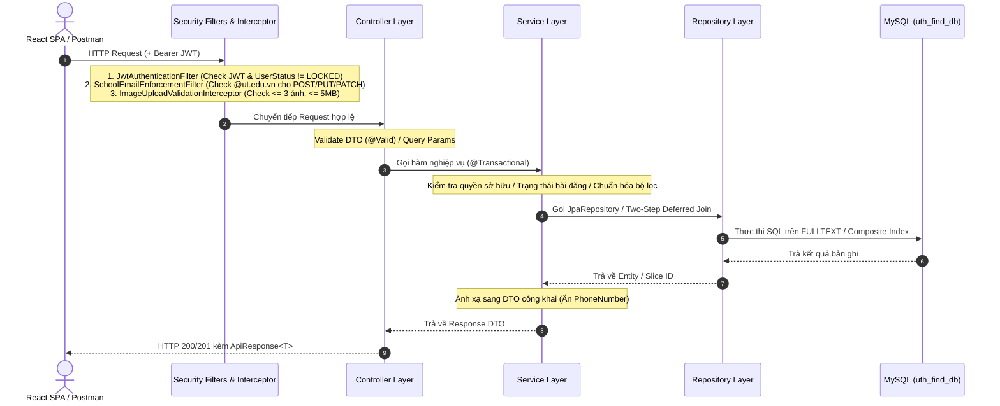

# Hệ Thống Tìm Kiếm Đồ Thất Lạc Trong Trường Học — Campus Lost & Found System (UTH)

Đồ án Công nghệ Phần mềm — Trường Đại học Giao thông vận tải TP.HCM (**UTH**).

Nền tảng Web tập trung hỗ trợ sinh viên, giảng viên, cán bộ nhân viên và bộ phận quản lý (Ban Quản trị, Đội Bảo vệ, Phòng Công tác Sinh viên) đăng tin báo mất đồ (`LOST`) hoặc nhặt được đồ (`FOUND`), tìm kiếm toàn văn (Full-text Search) kết hợp lọc đa tiêu chí, xác minh quyền sở hữu (`Claim`) và quản lý hoàn trả tài sản thất lạc trong khuôn viên trường học.

---

## ✨ Tính Năng Trọng Tâm & Kiến Trúc Giải Pháp

- **Xác thực SSO trường học & Phân quyền RBAC 5 vai trò:** Đăng nhập bằng Google Identity Services (OAuth 2.0 ID Token), bắt buộc đuôi email trường (`@ut.edu.vn`, `@uth.edu.vn`), tự động trích xuất Mã số sinh viên (`StudentID`) khi tạo tài khoản lần đầu, cấp phát Stateless JWT (`HS256`) và phân quyền 5 vai trò: `STUDENT`, `STAFF`, `ADMIN`, `SECURITY`, `SAC`.
- **Bảo vệ quyền riêng tư theo thiết kế (Privacy by Design):** Tuyệt đối ẩn số điện thoại cá nhân (`PhoneNumber`) của người đăng trên toàn bộ API danh sách và chi tiết bài đăng công khai.
- **Tối ưu & Dự phòng lưu trữ hình ảnh:** Middleware kiểm soát tối đa **3 ảnh/bài đăng**, dung lượng **≤ 5MB/ảnh** (`JPG`, `JPEG`, `PNG`, `WEBP`), tự động thu phóng (`≤ 1280x1280px`) và nén JPEG (`0.75`) trên Server bằng `Thumbnailator` trước khi đẩy lên **Cloudinary CDN** (tự động fallback sang **Local Storage `/uploads/**`** khi chưa cấu hình khóa Cloudinary).
- **Tìm kiếm Full-text & Lọc kết hợp hiệu năng cao:** Tối ưu cho quy mô **50.000+ bản ghi** với thời gian phản hồi **< 1.5 giây** nhờ MySQL `FULLTEXT INDEX (Title, Description)`, các Composite B-tree Index, bộ chuẩn hóa từ khóa Boolean Mode + InnoDB Stopwords tiếng Việt (`FullTextQueryHelper`) và kỹ thuật **Two-Step Deferred Join**.
- **Quản lý vòng đời bài đăng:** Hỗ trợ tạo bài đăng (tự động `APPROVED` cho `ADMIN`/`SECURITY`/`SAC` khi đăng tin lưu kho, hoặc `PENDING` chờ duyệt cho `STUDENT`/`STAFF`), chỉnh sửa khi bài chưa đóng, xóa bài và đánh dấu **"Đã nhận lại"** (`RESOLVED` / `CLAIMED`).

---

## 🛠️ Công Nghệ Sử Dụng (Tech Stack)

| Phân hệ | Công nghệ & Thư viện chính |
| :--- | :--- |
| **Backend (`backend/`)** | Java `17` (tương thích tới JDK `26`), Spring Boot `3.3.4`, Spring Web, Spring Data JPA (Hibernate `6.5`), Spring Security `6`, Bean Validation, Google API Client `2.7.0`, JJWT `0.12.6`, Cloudinary `1.39.0`, Thumbnailator `0.4.20`, SpringDoc OpenAPI / Swagger UI `2.6.0`, Lombok `1.18.48`, JUnit 5 & MockMvc |
| **Frontend (`frontend/`)** | React `18.3.1`, TypeScript `~5.6.2`, Vite `6.0.5`, React Router DOM `6.28.0` (Lazy Loading), Axios `1.7.9` (JWT Interceptors), React Hook Form `7.54.2`, Zod `3.23.8`, CSS Modules, Vitest `2.1.8` & React Testing Library |
| **Database** | MySQL `8.x` (`InnoDB`, `utf8mb4_unicode_ci`, Schema `uth_find_db` chuẩn hóa 3NF gồm 6 bảng: `User`, `Category`, `Location`, `ItemPost`, `ItemImage`, `ClaimRequest`) |

---

## 🏛️ Kiến Trúc Hệ Thống (Layered Modular Monolith & React SPA)

```text
┌──────────────────────────────────────────────────────────────────────┐
│                   Frontend SPA (React 18 + Vite)                     │
│   Layouts (Main / Auth / Admin) ──► Pages & FilterSidebar ──► Axios  │
└──────────────────────────────────┬───────────────────────────────────┘
                                   │ HTTP / HTTPS (JSON & Multipart + Bearer JWT)
                                   ▼
┌──────────────────────────────────────────────────────────────────────┐
│                   Backend REST API (Spring Boot 3)                   │
│                                                                      │
│  [0] Security & Validation Pipeline                                  │
│      ├── CorsConfig & Multipart Limit (<= 5MB/ảnh, <= 20MB/request)  │
│      ├── JwtAuthenticationFilter (Verify JWT & chặn User LOCKED)     │
│      ├── SchoolEmailEnforcementFilter (Cưỡng chế @ut.edu.vn)         │
│      └── ImageUploadValidationInterceptor (<= 3 ảnh, MIME & đuôi)    │
│                                  │                                   │
│                                  ▼                                   │
│  [1] Controller Layer (@RestController)                              │
│      └── AuthController, PostController, ImageUploadController       │
│                                  │ DTO Request (@Valid)              │
│                                  ▼                                   │
│  [2] Service Layer (@Service, @Transactional)                        │
│      └── AuthService, PostService, ImageStorageService               │
│                                  │ Entity / Custom Query             │
│                                  ▼                                   │
│  [3] Repository Layer (Spring Data JPA + Custom Native SQL)          │
│      └── ItemPostRepository (+ ItemPostRepositoryImpl Deferred Join) │
│      └── UserRepository, CategoryRepository, LocationRepository...   │
│                                  │ JDBC / HikariCP                   │
│                                  ▼                                   │
│  [4] MySQL 8.x (uth_find_db)  &  Cloudinary CDN / Local (/uploads)   │
└──────────────────────────────────────────────────────────────────────┘
```

---

## 📁 Cây Thư Mục Dự Án (Project Directory Tree)

```text
Capstone-Project-On-Software-Engineering-UTH/
│
├── .gitignore
├── README.md
│
├── docs/                                               # Tài liệu Kiến trúc & Sơ đồ thiết kế
│   ├── SAD_He_Thong_Tim_Kiem_Do_That_Lac.md            # Tài liệu Kiến trúc Giải pháp (SAD)
│   └── diagrams/                                       # Sơ đồ C4 (Context, Container, Component, Deployment), ERD, State Machine, Sequence
│
├── backend/                                            # Phân hệ Backend (Spring Boot 3.3.4 - Maven)
│   ├── pom.xml
│   └── src/
│       ├── main/
│       │   ├── java/com/uth/capstone/
│       │   │   ├── BackendApplication.java             # Điểm khởi chạy ứng dụng Spring Boot
│       │   │   ├── config/                             # Cấu hình hệ thống & Interceptor
│       │   │   │   ├── CloudinaryConfig.java           # Cấu hình Cloudinary SDK & kiểm tra khóa
│       │   │   │   ├── CorsConfig.java                 # Cấu hình CORS cho Frontend (3000, 5173, 8080)
│       │   │   │   ├── ImageUploadValidationInterceptor.java # Middleware chặn >3 ảnh, >5MB, sai định dạng
│       │   │   │   ├── JpaAuditingConfig.java          # Cấu hình JPA Auditing
│       │   │   │   ├── OpenApiConfig.java              # Cấu hình Swagger UI / OpenAPI 3
│       │   │   │   ├── SecurityConfig.java             # Chuỗi filter bảo mật & phân quyền RBAC
│       │   │   │   └── WebMvcConfig.java               # Đăng ký Interceptor & static resource /uploads/**
│       │   │   ├── controller/                         # Tầng Presentation (REST Endpoints)
│       │   │   │   ├── AuthController.java             # POST /api/auth/google, GET /api/auth/me
│       │   │   │   ├── ImageUploadController.java      # POST /api/images/upload
│       │   │   │   └── PostController.java             # GET/POST /posts, GET/PUT/DELETE /posts/{id}, PATCH /posts/{id}/status
│       │   │   ├── dto/                                # Data Transfer Objects
│       │   │   │   ├── request/                        # GoogleLoginRequest, CreatePostRequest, UpdatePostRequest, UpdatePostStatusRequest, PostSearchRequest
│       │   │   │   └── response/                       # ApiResponse, AuthResponse, UserResponse, PostResponse (ẩn PhoneNumber), PageResponse, ImageUploadResponse
│       │   │   ├── entity/                             # JPA Entities ánh xạ bảng MySQL
│       │   │   │   ├── BaseEntity.java
│       │   │   │   ├── User.java                       # Bảng User
│       │   │   │   ├── Category.java                   # Bảng Category (6 danh mục chuẩn)
│       │   │   │   ├── Location.java                   # Bảng Location (61 vị trí tòa nhà/tầng/phòng)
│       │   │   │   ├── ItemPost.java                   # Bảng ItemPost (Full-text & Composite Indexes)
│       │   │   │   └── ItemImage.java                  # Bảng ItemImage
│       │   │   ├── enums/                              # Các kiểu liệt kê nghiệp vụ
│       │   │   │   ├── Role.java                       # STUDENT, STAFF, ADMIN, SECURITY, SAC
│       │   │   │   ├── UserStatus.java                 # ACTIVE, LOCKED
│       │   │   │   ├── ItemType.java                   # LOST, FOUND
│       │   │   │   ├── PostStatus.java                 # PENDING, APPROVED, CLAIMED, RESOLVED, EXPIRED, REJECTED
│       │   │   │   ├── PostFilterStatus.java           # Bộ lọc trạng thái (LOST, FOUND, RETURNED, ALL...)
│       │   │   │   ├── PostSortBy.java                 # NEWEST, OLDEST, RELEVANCE
│       │   │   │   └── ClaimStatus.java                # SUBMITTED, ACCEPTED, REJECTED
│       │   │   ├── exception/                          # Xử lý ngoại lệ tập trung
│       │   │   │   ├── AppException.java
│       │   │   │   ├── ErrorCode.java                  # Danh mục 24 mã lỗi chuẩn hóa (1001..1023, 9999)
│       │   │   │   └── GlobalExceptionHandler.java     # @RestControllerAdvice chuẩn hóa JSON lỗi
│       │   │   ├── repository/                         # Tầng truy xuất dữ liệu
│       │   │   │   ├── UserRepository.java
│       │   │   │   ├── CategoryRepository.java
│       │   │   │   ├── LocationRepository.java
│       │   │   │   ├── ItemImageRepository.java
│       │   │   │   ├── ItemPostRepository.java         # @EntityGraph & LEFT JOIN FETCH theo danh sách ID
│       │   │   │   ├── ItemPostRepositoryCustom.java   # Interface truy vấn tìm kiếm tùy biến
│       │   │   │   └── ItemPostRepositoryImpl.java     # Two-Step Deferred Join, Full-text Search & Short-token Fallback
│       │   │   ├── security/                           # Bảo mật OAuth2, JWT & Kiểm tra Email trường
│       │   │   │   ├── JwtTokenProvider.java
│       │   │   │   ├── JwtAuthenticationFilter.java
│       │   │   │   ├── SchoolEmailValidator.java
│       │   │   │   ├── SchoolEmailEnforcementFilter.java
│       │   │   │   ├── CustomUserDetails.java
│       │   │   │   ├── CustomUserDetailsService.java
│       │   │   │   ├── CustomAuthenticationEntryPoint.java
│       │   │   │   └── CustomAccessDeniedHandler.java
│       │   │   ├── service/                            # Tầng xử lý logic nghiệp vụ
│       │   │   │   ├── AuthService.java
│       │   │   │   ├── ImageStorageService.java
│       │   │   │   └── PostService.java
│       │   │   └── util/
│       │   │       └── FullTextQueryHelper.java        # Chuẩn hóa từ khóa MySQL Boolean Mode & InnoDB Stopwords
│       │   └── resources/
│       │       └── application.yml                     # Cấu hình Server, MySQL, Hibernate, JWT, Google, Storage
│       └── test/java/com/uth/capstone/                 # Bộ kiểm thử JUnit 5, Mockito & Spring MockMvc
│           ├── AuthSecurityTest.java
│           ├── controller/
│           │   ├── PostControllerTest.java
│           │   └── PostSearchControllerTest.java
│           └── service/
│               ├── ImageStorageServiceTest.java
│               └── PostServiceTest.java
│
└── frontend/                                           # Phân hệ Frontend (React 18 + TypeScript + Vite)
    ├── package.json
    ├── vite.config.ts
    └── src/
        ├── main.tsx
        ├── app/                                        # Cấu hình App, Providers & React Router v6 (router.tsx)
        ├── components/                                 # Header, FilterSidebar (Drawer/Sidebar), LoadingSpinner
        ├── constants/                                  # Routes, API_BASE_URL, STORAGE_KEYS
        ├── layouts/                                    # MainLayout, AuthLayout, AdminLayout
        ├── pages/                                      # HomePage, PostsPage, PostDetailPage, PostNewPage, ClaimPage, MyClaimsPage, ProfilePage, LoginPage, admin/*
        ├── services/api/                               # axiosClient.ts (Interceptors) & apiEndpoints.ts
        ├── styles/                                     # global.css (Design System & Responsive Variables)
        └── types/                                      # Định nghĩa TypeScript Interfaces (Post, User, Claim, PostFilters...)
```

---

## 🔌 Danh Mục RESTful API Đã Triển Khai Trên Backend

Mọi phản hồi từ Backend đều tuân theo cấu trúc chuẩn `ApiResponse<T>`:
```json
{
  "code": 200,
  "message": "Success",
  "result": { ... },
  "timestamp": "2026-11-19T21:00:00"
}
```

| Nhóm | Method & Endpoint | Quyền truy cập | Mô tả chức năng |
| :--- | :--- | :--- | :--- |
| **Auth** | `POST /api/auth/google` | Công khai | Xác thực Google `idToken`, kiểm tra email `@ut.edu.vn`, chặn user `LOCKED`, tự tạo tài khoản mới (nếu lần đầu) và cấp JWT. |
| **Auth** | `GET /api/auth/me` | Đã đăng nhập | Lấy thông tin chi tiết người dùng hiện tại từ JWT Bearer Token. |
| **Images** | `POST /api/images/upload` | Đã đăng nhập | Upload `multipart/form-data` (`files`): kiểm tra `≤ 3` ảnh, `≤ 5MB`/ảnh, tự động thu phóng & nén JPEG trước khi lưu lên Cloudinary hoặc `/uploads/**`. |
| **Posts** | `GET /api/posts` *(hoặc `/posts`)* | Công khai | Tìm kiếm Full-text (`keyword`/`q`) trên `Title` & `Description`, lọc kết hợp 4 tiêu chí (`status`, `itemType`/`type`, `categoryId`, `locationId`/`buildingName`, `fromDate`/`dateFrom` – `toDate`/`dateTo`), sắp xếp (`NEWEST`, `OLDEST`, `RELEVANCE`) và phân trang (`page`, `size`/`limit`). Ẩn `phoneNumber`. |
| **Posts** | `POST /api/posts` *(hoặc `/posts`)* | Đã đăng nhập (`@ut.edu.vn`) | Tạo bài đăng mới (`LOST`/`FOUND`). Tự động `APPROVED` cho `ADMIN`/`SECURITY`/`SAC` (hoặc khi bật `auto-approve`), mặc định `PENDING` cho `STUDENT`/`STAFF`. |
| **Posts** | `GET /api/posts/{id}` *(hoặc `/posts/{id}`)* | Công khai | Xem chi tiết bài đăng kèm danh mục, địa điểm, ảnh và thông tin người đăng (**ẩn `PhoneNumber`**). |
| **Posts** | `PUT /api/posts/{id}` *(hoặc `/posts/{id}`)* | Chính tác giả | Chỉnh sửa bài đăng của chính mình khi bài chưa đóng (`PENDING` hoặc `APPROVED`). |
| **Posts** | `DELETE /api/posts/{id}` *(hoặc `/posts/{id}`)* | Chính tác giả | Xóa bài đăng của chính mình (cascade xóa ảnh đính kèm). |
| **Posts** | `PATCH /api/posts/{id}/status` *(hoặc `/posts/{id}/status`)* | Chính tác giả | Đánh dấu trạng thái bài đăng thành **"Đã nhận lại"** (`RESOLVED` hoặc `CLAIMED`). |

---

## 🔄 Luồng Xử Lý Thực Thi Tiêu Biểu (Request Flow)



---

## ⚙️ Hướng Dẫn Cài Đặt & Chạy Dự Án

### 1. Cấu hình Biến Môi Trường Backend (`backend/.env`)
Tạo file `backend/.env` (đã được đưa vào `.gitignore`) với các thông số kết nối:

```properties
DB_PASSWORD=<mat_khau_mysql>
JWT_SECRET=<chuoi_bi_mat_base64_hoac_32_ky_tu_tro_len>
JWT_EXPIRATION_MS=86400000
GOOGLE_CLIENT_ID=<google_oauth2_client_id>
ALLOWED_EMAIL_DOMAINS=ut.edu.vn,uth.edu.vn
POST_AUTO_APPROVE=false

# Lưu trữ ảnh: chọn 'cloudinary' hoặc 'local' (tự fallback sang 'local' nếu để trống key Cloudinary)
STORAGE_PROVIDER=cloudinary
CLOUDINARY_CLOUD_NAME=
CLOUDINARY_API_KEY=
CLOUDINARY_API_SECRET=
CLOUDINARY_FOLDER=uth_lost_and_found
```

### 2. Khởi chạy & Kiểm thử Backend (`Port 8080`)
```powershell
cd backend

# Chạy ứng dụng Spring Boot
mvn spring-boot:run

# Chạy bộ Unit Test & @WebMvcTest (thêm -Dnet.bytebuddy.experimental=true nếu dùng JDK 24+)
mvn test "-Dnet.bytebuddy.experimental=true"
```
- **Swagger UI (Tài liệu & Thử nghiệm API trực quan):** `http://localhost:8080/swagger-ui.html`
- **OpenAPI JSON Spec:** `http://localhost:8080/v3/api-docs`

### 3. Khởi chạy & Kiểm thử Frontend (`Port 5173`)
```powershell
cd frontend

# Cài đặt dependencies
npm install

# Chạy Vite Dev Server
npm run dev

# Build kiểm tra TypeScript & Bundle Production
npm run build
```
- **Giao diện Web:** `http://localhost:5173`

---

## 📐 Quy Ước Đặt Tên Trong Dự Án (Naming Conventions)

| Thành phần | Quy tắc đặt tên | Ví dụ thực tế trong Source Code |
| :--- | :--- | :--- |
| **Entity** | Danh từ số ít, PascalCase (khớp tên bảng MySQL) | `User.java`, `ItemPost.java`, `ItemImage.java`, `Category.java`, `Location.java` |
| **Repository** | `<TênEntity>Repository` (+ `Custom` / `Impl`) | `ItemPostRepository.java`, `ItemPostRepositoryCustom.java`, `ItemPostRepositoryImpl.java` |
| **Service** | `<TênNghiệpVụ>Service` | `AuthService.java`, `PostService.java`, `ImageStorageService.java` |
| **Controller** | `<TênNghiệpVụ>Controller` | `AuthController.java`, `PostController.java`, `ImageUploadController.java` |
| **Request DTO** | `<HànhĐộng><TênThựcThể>Request` | `GoogleLoginRequest.java`, `CreatePostRequest.java`, `UpdatePostRequest.java`, `PostSearchRequest.java` |
| **Response DTO** | `<TênThựcThể>Response` | `ApiResponse.java`, `AuthResponse.java`, `PostResponse.java`, `PageResponse.java`, `ImageUploadResponse.java` |
