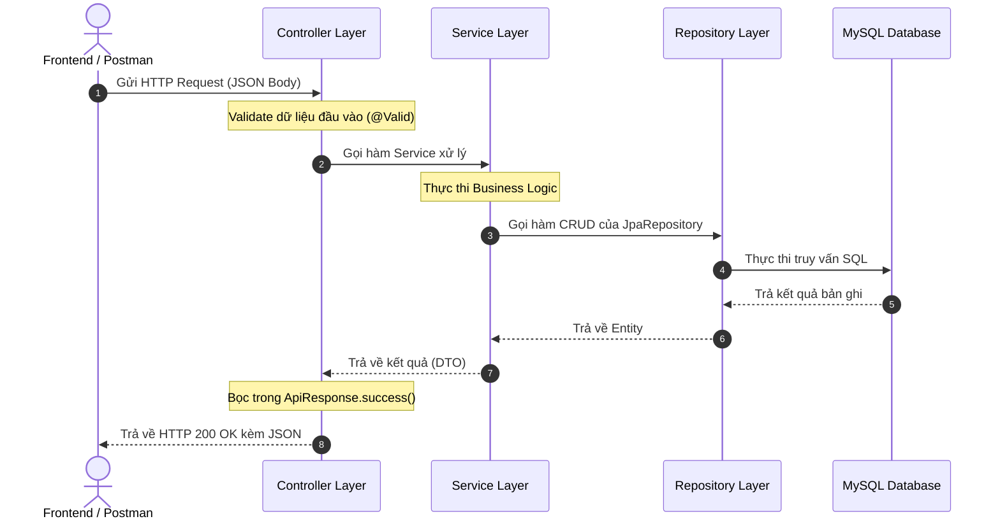

# Capstone-Project-On-Software-Engineering-UTH

Đồ án Công nghệ Phần mềm - Trường Đại học Giao thông vận tải TP.HCM (UTH).

---

## 🏛️ Kiến Trúc Hệ Thống Backend (Layered Architecture - Tinh Gọn)

Dự án Backend sử dụng **Spring Boot 3** với mô hình **Layered Architecture (Kiến trúc phân tầng)** chuẩn mực nhưng được tinh gọn tối đa, phù hợp cho quy mô đồ án đại học.

```
┌─────────────────────────────────────────────────────────────┐
│                    Client (Web / Mobile)                    │
└──────────────────────────────┬──────────────────────────────┘
                               │ HTTP Request (JSON)
                               ▼
┌─────────────────────────────────────────────────────────────┐
│                     BACKEND APPLICATION                     │
│                                                             │
│  [1] Controller Layer (@RestController)                     │
│      └── Tiếp nhận request, validate dữ liệu (@Valid)       │
│                               │ DTO (Request)               │
│                               ▼                             │
│  [2] Service Layer (@Service)                               │
│      └── Xử lý toàn bộ logic nghiệp vụ (Business Rules)     │
│                               │ Entity                      │
│                               ▼                             │
│  [3] Repository Layer (@Repository, JpaRepository)          │
│      └── Truy vấn CSDL tự động qua Spring Data JPA          │
│                               │ SQL                         │
│                               ▼                             │
│  [4] Database (MySQL)                                       │
│                                                             │
│  [Hỗ trợ xuyên suốt]                                        │
│  ├── DTO: Đối tượng truyền nhận dữ liệu (Request/Response)  │
│  ├── Entity: Ánh xạ cấu trúc bảng CSDL                      │
│  ├── Config: Cấu hình CORS, Swagger UI, Security, Auditing  │
│  └── Exception: Bắt và chuẩn hóa mã lỗi toàn cục            │
└─────────────────────────────────────────────────────────────┘
```

---

## 📁 Cây Thư Mục Dự Án (Project Directory Tree)

```text
Capstone-Project-On-Software-Engineering-UTH/
│
├── .gitignore                                  # Git ignore cấp dự án
├── README.md                                   # Tài liệu hướng dẫn dự án
│
└── backend/                                    # Mã nguồn Backend (Spring Boot 3)
    ├── .gitignore                              # Git ignore cho backend (bỏ qua target, file tạm IDE)
    ├── pom.xml                                 # Khai báo dependencies Maven (Web, JPA, Security, Lombok, MySQL...)
    │
    └── src/
        └── main/
            ├── java/
            │   └── com/
            │       └── uth/
            │           └── capstone/
            │               ├── BackendApplication.java         # Điểm khởi chạy ứng dụng (Main class)
            │               │
            │               ├── config/                         # [Cấu hình hệ thống]
            │               │   ├── CorsConfig.java             # Cấu hình CORS (kết nối React, Vue, Vite...)
            │               │   ├── JpaAuditingConfig.java      # Tự động lưu createdAt, updatedAt
            │               │   ├── OpenApiConfig.java          # Cấu hình Swagger / OpenAPI Documentation
            │               │   └── SecurityConfig.java         # Cấu hình bảo mật, mở quyền truy cập API
            │               │
            │               ├── controller/                     # [Tầng Controller - Presentation Layer]
            │               │   └── (Tiếp nhận HTTP request từ Client, điều hướng sang Service)
            │               │
            │               ├── dto/                            # [Data Transfer Objects]
            │               │   ├── request/                    # DTO chứa dữ liệu Client gửi lên
            │               │   └── response/                   # DTO chứa dữ liệu trả về cho Client
            │               │       └── ApiResponse.java        # Chuẩn hóa JSON trả về {code, message, result}
            │               │
            │               ├── entity/                         # [Tầng Entity - Data Model Layer]
            │               │   ├── BaseEntity.java             # Lớp cha chứa các cột dùng chung (createdAt, updatedAt)
            │               │   └── (Các JPA Entity ánh xạ trực tiếp đến bảng trong MySQL)
            │               │
            │               ├── exception/                      # [Tầng Xử lý ngoại lệ tập trung]
            │               │   ├── AppException.java           # Ngoại lệ tùy biến cho nghiệp vụ
            │               │   ├── ErrorCode.java              # Danh mục mã lỗi và HTTP status thống nhất
            │               │   └── GlobalExceptionHandler.java # Bắt mọi lỗi phát sinh và trả về JSON chuẩn
            │               │
            │               ├── repository/                     # [Tầng Repository - Data Access Layer]
            │               │   └── (Interface kế thừa JpaRepository để thao tác CRUD với CSDL)
            │               │
            │               └── service/                        # [Tầng Service - Business Logic Layer]
            │                   └── (Viết trực tiếp các class @Service xử lý nghiệp vụ, không cần chia nhỏ impl)
            │
            └── resources/
                └── application.yml                             # File cấu hình duy nhất (Port, MySQL DB, Hibernate, Swagger)
```

---

## 🔍 Chi Tiết Trách Nhiệm Từng Tầng (Layer Responsibilities)

| Tầng / Folder | Thành phần chính | Mô tả vai trò |
| :--- | :--- | :--- |
| **`controller`** | `@RestController`, `@RequestMapping` | Nhận HTTP Request từ Client (GET, POST, PUT, DELETE), kiểm tra dữ liệu đầu vào (`@Valid`), gọi Service tương ứng và trả về kết quả qua `ApiResponse<T>`. |
| **`service`** | `@Service`, `@Transactional` | Nơi tập trung toàn bộ code xử lý nghiệp vụ (kiểm tra tính hợp lệ nghiệp vụ, tính toán, gọi Repository lưu trữ dữ liệu). Viết trực tiếp Class Service, không cần ép tạo Interface + Impl giúp giảm thiểu số lượng file. |
| **`repository`** | `@Repository`, `JpaRepository` | Giao tiếp trực tiếp với cơ sở dữ liệu. Spring Data JPA tự động cung cấp các hàm `findAll()`, `findById()`, `save()`, `deleteById()` mà không cần viết lệnh SQL thủ công. |
| **`entity`** | `@Entity`, `@Table` | Đại diện cho các bảng dữ liệu trong CSDL. Các entity kế thừa `BaseEntity` sẽ tự động có 2 cột `created_at` và `updated_at`. |
| **`dto`** | Request & Response Classes | Ngăn ngừa việc truyền trực tiếp Entity ra ngoài. `request/` chứa dữ liệu Client gửi lên; `response/` chứa dữ liệu trả về kèm `ApiResponse.java` chuẩn hóa. |
| **`config`** | `@Configuration` | Chứa toàn bộ cấu hình: CORS kết nối Frontend, Swagger UI tài liệu hóa API, bật JPA Auditing, và cấu hình Spring Security. |
| **`exception`** | `@RestControllerAdvice` | Xử lý lỗi toàn cục. Khi Service quăng `throw new AppException(ErrorCode.USER_NOT_EXISTED)`, `GlobalExceptionHandler` sẽ tự động bắt và trả về JSON lỗi rõ ràng cho Frontend. |

---

## 🔄 Luồng Dữ Liệu Thực Thi (Request Flow)



---

## 📐 Quy Ước Đặt Tên Chuẩn (Naming Conventions)

| Thành phần | Quy tắc đặt tên | Ví dụ thực tế |
| :--- | :--- | :--- |
| **Entity** | Danh từ số ít, PascalCase | `User.java`, `Product.java`, `Order.java` |
| **Repository** | `<TênEntity>Repository` | `UserRepository.java`, `ProductRepository.java` |
| **Service** | `<TênEntity>Service` | `UserService.java`, `ProductService.java` |
| **Controller** | `<TênEntity>Controller` | `UserController.java`, `ProductController.java` |
| **Request DTO** | `<HànhĐộng><TênEntity>Request` | `CreateUserRequest.java`, `LoginRequest.java` |
| **Response DTO** | `<TênEntity>Response` | `UserResponse.java`, `OrderResponse.java` |

---

--- 
test
---