# Tài liệu Kiến trúc Giải pháp (SAD) — Hệ thống Tìm kiếm Đồ thất lạc trong Trường học

> **Phiên bản:** 1.0  
> **Cập nhật lần cuối:** 14/11/2026  
> **Dự án:** Hệ thống Tìm kiếm Đồ thất lạc trong Trường học — Campus Lost & Found System  
> **Đơn vị áp dụng:** Trường Đại học Giao thông vận tải TP.HCM (UTH)  
> **Mục đích:** Tài liệu hóa kiến trúc giải pháp sử dụng các thực hành tốt nhất hiện đại
---

## Mục lục

1. [Tóm tắt Điều hành](#1-tóm-tắt-điều-hành)
2. [Tầm nhìn Kiến trúc](#2-tầm-nhìn-kiến-trúc)
3. [Yêu cầu Nghiệp vụ](#3-yêu-cầu-nghiệp-vụ)
4. [Cơ sở Công nghệ](#4-cơ-sở-công-nghệ)
5. [Ngữ cảnh Hệ thống (C4 Cấp 1)](#5-ngữ-cảnh-hệ-thống-c4-cấp-1)
6. [Khung nhìn Logic (C4 Cấp 2 - Container)](#6-khung-nhìn-logic-c4-cấp-2---container)
7. [Khung nhìn Thành phần (C4 Cấp 3)](#7-khung-nhìn-thành-phần-c4-cấp-3)
8. [Kiến trúc Dữ liệu & ERD](#8-kiến-trúc-dữ-liệu--erd)
9. [Tích hợp & Luồng Dữ liệu](#9-tích-hợp--luồng-dữ-liệu)
10. [Kiến trúc Bảo mật](#10-kiến-trúc-bảo-mật)
11. [Khung nhìn Triển khai](#11-khung-nhìn-triển-khai)
12. [Yêu cầu Phi Chức năng](#12-yêu-cầu-phi-chức-năng)
13. [Quyết định Kiến trúc](#13-quyết-định-kiến-trúc)
14. [Rủi ro & Giảm thiểu](#14-rủi-ro--giảm-thiểu)

---

## 1. Tóm tắt Điều hành

### 1.1 Mục đích
Tài liệu Kiến trúc Giải pháp (SAD) này mô tả toàn diện cấu trúc kiến trúc phần mềm, mô hình dữ liệu, sơ đồ trạng thái nghiệp vụ, đặc tả hợp đồng giao tiếp API, cơ chế bảo mật phân quyền, nguyên tắc thiết kế giao diện và phương án triển khai cho **Hệ thống Tìm kiếm Đồ thất lạc trong Trường học – Campus Lost & Found System** tại Trường Đại học Giao thông vận tải TP.HCM (UTH).

Giải pháp hướng tới việc xây dựng một nền tảng Web tập trung, chính thống giúp sinh viên, giảng viên, cán bộ nhân viên nhà trường và bộ phận quản lý (Ban Quản trị, Đội Bảo vệ, Phòng Công tác Sinh viên) đăng tải, tra cứu, xác minh quyền sở hữu và bàn giao tài sản thất lạc trong khuôn viên trường học một cách nhanh chóng, minh bạch và bảo mật.

### 1.2 Phạm vi
* **Trong phạm vi kiến trúc (In-Scope):**
  * **Ứng dụng Web Responsive (Frontend SPA):** Hoạt động trên cả trình duyệt máy tính và thiết bị di động (`320px` đến `1440px+`), hỗ trợ đăng nhập SSO bằng tài khoản Google trường, đăng tin Mất đồ (`LOST`) / Nhặt được (`FOUND`), tìm kiếm – lọc – sắp xếp bài đăng, gửi yêu cầu xác minh nhận lại đồ (`Claim`) và giao diện quản trị (`Admin Portal`).
  * **Hệ thống Backend RESTful API (Spring Boot 3):** Cung cấp các dịch vụ xác thực Google OAuth2 + cấp phát JWT, phân quyền RBAC 5 vai trò (`STUDENT`, `STAFF`, `ADMIN`, `SECURITY`, `SAC`), kiểm duyệt giới hạn & tự động nén ảnh tải lên (Cloudinary / Local Storage), quản lý vòng đời bài đăng (`ItemPost`), quy trình xác minh nhận đồ (`ClaimRequest`) và kiểm duyệt/thống kê quản trị.
  * **Cơ sở dữ liệu Quan hệ (MySQL 8.x):** Thiết kế chuẩn hóa 3NF gồm 6 bảng cốt lõi (`User`, `Category`, `Location`, `ItemPost`, `ItemImage`, `ClaimRequest`), tích hợp chỉ mục tìm kiếm toàn văn (`FULLTEXT INDEX`) và chỉ mục lọc đa tiêu chí.
* **Ngoài phạm vi kiến trúc (Out-of-Scope):**
  * Ứng dụng di động gốc (Native iOS / Android App độc lập trên App Store / Google Play).
  * Cổng thanh toán trực tuyến hoặc thu phí dịch vụ.
  * Hệ thống nhắn tin thời gian thực (Real-time Chat WebSocket) giữa các cá nhân (việc liên lạc trực tiếp chỉ được mở khóa sau khi yêu cầu nhận đồ `ClaimRequest` được chấp thuận).

### 1.3 Mục tiêu Chính
- **Tập trung hóa thông tin thất lạc:** Thay thế các kênh tự phát, phân tán và dễ trôi tin trên mạng xã hội (Facebook Groups, Confessions) bằng một cổng thông tin tập trung, phân loại chuẩn xác theo danh mục đồ vật và vị trí tòa nhà/phòng học trong trường UTH.
- **Xác thực danh tính & Chống gian lận:** Bắt buộc xác thực bằng tài khoản email trường học (`@ut.edu.vn` / `@uth.edu.vn`) qua Google Identity Services (OAuth 2.0) và cung cấp quy trình xác minh bằng chứng sở hữu (`Claim Verification`) trước khi trao trả.
- **Bảo vệ quyền riêng tư cá nhân (Privacy by Design):** Tuyệt đối ẩn số điện thoại cá nhân (`PhoneNumber`) của người đăng trên mọi API công khai nhằm ngăn chặn hành vi mạo danh, quấy rối hoặc lừa đảo; chỉ hiển thị kênh liên lạc khi yêu cầu nhận lại đồ được chấp nhận (`ACCEPTED`).
- **Hỗ trợ công tác quản trị & an ninh trường học:** Cung cấp công cụ cho Đội Bảo vệ / Phòng Công tác Sinh viên kiểm duyệt nội dung, tiếp nhận đồ lưu kho, khóa tài khoản vi phạm và thống kê các khu vực điểm nóng thường xảy ra mất đồ (`Hotspot Analysis`).

### 1.4 Tiêu chí Thành công
- **Hiệu năng tra cứu:** Thời gian phản hồi truy vấn tìm kiếm và lọc kết quả đạt dưới **1.5 giây** với quy mô cơ sở dữ liệu lên tới **50.000 bản ghi** (`SRS Mục 6.2`).
- **Trải nghiệm người dùng (Usability):** Giao diện tối ưu cho thiết bị di động; sinh viên hoàn thành biểu mẫu đăng tin mất/nhặt đồ trong thời gian dưới **2 phút** (`SRS Mục 6.1`).
- **Tối ưu tài nguyên lưu trữ:** Kiểm soát chặt chẽ tối đa **3 ảnh/bài đăng**, dung lượng gốc tối đa **5MB/ảnh**, và tự động nén/thu phóng ảnh trên máy chủ trước khi lưu trữ lên Cloudinary hoặc Local Storage (`SRS Mục 2.4 & 4.4`).
- **Độ tin cậy bảo mật:** 100% các thao tác tạo dữ liệu (Đăng bài, Sửa/Xóa, Gửi Claim, Upload ảnh, Quản trị) được bảo vệ bởi chuỗi bộ lọc xác thực JWT và kiểm tra tên miền email trường học.

---

## 2. Tầm nhìn Kiến trúc

### 2.1 Tuyên bố Tầm nhìn
CLFS v1.0 được định hình là một **Ứng dụng Web Độc lập (Standalone Web Application)** vận hành theo mô hình **Client–Server phân tách (Decoupled SPA Frontend & Layered Modular Monolith Backend)**. Hệ thống tận dụng hạ tầng xác thực đám mây của Google Workspace giáo dục (`@ut.edu.vn`), lưu trữ đám mây Cloudinary kết hợp cơ sở dữ liệu quan hệ MySQL tập trung, đảm bảo tính đơn giản trong triển khai, tính nhất quán dữ liệu cao (ACID) và khả năng mở rộng linh hoạt theo từng giai đoạn phát triển.

### 2.2 Nguyên tắc Kiến trúc & Đánh giá Chất lượng Thiết kế (Cohesion & Coupling)

#### 2.2.1 Các Nguyên tắc Kiến trúc Cốt lõi
- **Nguyên tắc 1 — Kiến trúc Phân tầng Tinh gọn (Streamlined Layered Architecture):** Backend được tổ chức thành 4 tầng tách biệt rõ trách nhiệm: `Controller Layer` (tiếp nhận HTTP request & kiểm tra `@Valid`) $\rightarrow$ `Service Layer` (xử lý toàn bộ quy tắc nghiệp vụ & giao dịch `@Transactional`) $\rightarrow$ `Repository Layer` (truy xuất dữ liệu qua Spring Data JPA) $\rightarrow$ `Entity / Database Layer` (ánh xạ ORM với bảng MySQL). Các lớp `Service` được triển khai trực tiếp không qua lớp `Interface + Impl` dư thừa nhằm giảm độ phức tạp mã nguồn.
- **Nguyên tắc 2 — Xác thực Phi trạng thái (Stateless JWT Security):** Máy chủ Backend không lưu trữ phiên làm việc (`HttpSession`) trong bộ nhớ (`SessionCreationPolicy.STATELESS`). Mọi yêu cầu được xác thực độc lập thông qua chữ ký số trên JSON Web Token (`JWT HS256`) kết hợp kiểm tra trạng thái tài khoản trực tiếp.
- **Nguyên tắc 3 — Bảo mật và Quyền riêng tư theo Thiết kế (Security & Privacy by Design):** Không bao giờ trả trực tiếp đối tượng `Entity` ra ngoài Controller; mọi dữ liệu đầu vào/đầu ra bắt buộc đi qua lớp `DTO (Data Transfer Object)`. Đặc biệt, `PostResponse.AuthorPublicInfo` loại bỏ hoàn toàn trường `phoneNumber` ở cấp độ cấu trúc lớp để loại trừ rủi ro rò rỉ dữ liệu nhạy cảm.
- **Nguyên tắc 4 — Xử lý Lỗi Tập trung & Chuẩn hóa Phản hồi (Unified Response & Global Exception Handling):** Tất cả phản hồi API (thành công hoặc thất bại) đều tuân theo một cấu trúc JSON duy nhất là `ApiResponse<T>` gồm `{ code, message, result }`. Mọi ngoại lệ nghiệp vụ (`AppException` kèm `ErrorCode`) và lỗi hệ thống được bắt tập trung tại `GlobalExceptionHandler` (`@RestControllerAdvice`).
- **Nguyên tắc 5 — Khả năng Dự phòng Dịch vụ Lưu trữ (Storage Graceful Fallback):** Dịch vụ lưu trữ ảnh (`ImageStorageService`) hỗ trợ cơ chế chuyển đổi tự động: ưu tiên tải ảnh đã nén lên **Cloudinary CDN** khi có đầy đủ khóa cấu hình, và tự động chuyển hướng lưu xuống **Local Storage (`uploads/`)** nếu môi trường chạy chưa cấu hình khóa đám mây.

#### 2.2.2 Đánh giá Chất lượng Thiết kế theo Độ gắn kết (Cohesion) và Độ ghép nối (Coupling)
Theo nguyên lý Thiết kế Phần mềm (*Modularization, High Cohesion & Loose Coupling*), kiến trúc CLFS v1.0 đạt được sự phân tách mô-đun tối ưu:

| Tiêu chí Chất lượng | Đánh giá trong Hệ thống CLFS v1.0 | Minh chứng Kỹ thuật Thực tế trong Source Code |
|:--------------------|:----------------------------------|:----------------------------------------------|
| **Độ gắn kết cao (High Cohesion)** | Mỗi lớp và mỗi package chỉ đảm nhận **một trách nhiệm chức năng duy nhất (Single Responsibility)**. Các thao tác liên quan đến cùng một thực thể nghiệp vụ được gom nhóm chặt chẽ. | - `AuthService` chỉ xử lý xác thực Google, kiểm tra email trường và cấp JWT.<br>- `ImageStorageService` chỉ chuyên trách kiểm tra kích thước, nén ảnh bằng `Thumbnailator` và lưu trữ lên Cloudinary/Local.<br>- `PostService` chuyên trách quy tắc nghiệp vụ của bài đăng (`ItemPost`).<br>- `SchoolEmailValidator` chỉ thực hiện kiểm tra tên miền email hợp lệ. |
| **Độ ghép nối thấp (Loose Coupling)** | Các thành phần giao tiếp với nhau thông qua **Dependency Injection (`@RequiredArgsConstructor`)** và các đối tượng truyền tải dữ liệu (**DTO**), không phụ thuộc chặt vào chi tiết cài đặt của nhau. | - **Frontend $\leftrightarrow$ Backend:** Tách rời hoàn toàn qua hợp đồng REST JSON (`ApiResponse<T>`); thay đổi UI React không ảnh hưởng tới Spring Boot và ngược lại.<br>- **Controller $\leftrightarrow$ Entity:** Controller chỉ biết tới `CreatePostRequest`, `UpdatePostRequest`, `PostResponse`; việc thay đổi cấu trúc bảng CSDL không làm gãy hợp đồng API.<br>- **Business Logic $\leftrightarrow$ Cross-cutting Concerns:** Kiểm tra JWT (`JwtAuthenticationFilter`), kiểm tra đuôi email (`SchoolEmailEnforcementFilter`), giới hạn file ảnh (`ImageUploadValidationInterceptor`) và bắt lỗi (`GlobalExceptionHandler`) được tách thành Middleware độc lập, không làm bẩn code trong `Controller`/`Service`. |

### 2.3 Ràng buộc & Giả định
- **Ràng buộc (Constraints):**
  - *Ràng buộc Nghiệp vụ & Bảo mật:* Chỉ người dùng sở hữu email trường hợp lệ (`@ut.edu.vn`, `@uth.edu.vn`) và có trạng thái tài khoản `ACTIVE` mới được phép đăng tin hoặc gửi yêu cầu nhận đồ (`SRS Mục 2.4`).
  - *Ràng buộc Kỹ thuật:* Mỗi bài đăng đính kèm tối đa **3 ảnh**, dung lượng mỗi ảnh không vượt quá **5MB** (`5.242.880 bytes`), chỉ chấp nhận định dạng `JPG`, `JPEG`, `PNG`, `WEBP`.
  - *Ràng buộc Cơ sở dữ liệu:* Máy chủ MySQL chạy trên môi trường Linux phân biệt chữ hoa/thường đối với tên bảng và tên cột (PascalCase: `User`, `Category`, `Location`, `ItemPost`, `ItemImage`, `ClaimRequest`), do đó Hibernate bắt buộc cấu hình `PhysicalNamingStrategyStandardImpl` và `ddl-auto: validate`.
- **Giả định (Assumptions):**
  - Sinh viên, giảng viên và nhân viên trường UTH đều đã được nhà trường cấp tài khoản Google Workspace với tên miền `@ut.edu.vn` (hoặc `@uth.edu.vn`).
  - Người nhặt được đồ có thiện chí đăng tin trả lại hoặc bàn giao tài sản về Văn phòng Đoàn / Phòng Bảo vệ / Phòng Công tác Sinh viên của trường (`SRS Mục 2.5`).
  - Danh mục phân loại đồ vật (`Category` – 6 danh mục) và danh mục vị trí khuôn viên trường (`Location` – 61 vị trí tòa nhà/phòng học/khu vực) tương đối ổn định và được khởi tạo sẵn trong cơ sở dữ liệu.

---

## 3. Yêu cầu Nghiệp vụ

### 3.1 Vấn đề Nghiệp vụ
Hiện tại, khi sinh viên hoặc giảng viên làm mất hoặc nhặt được tài sản trong khuôn viên trường học, thông tin thường được đăng tải tự phát trên các hội nhóm mạng xã hội (Facebook Groups, trang Confessions) hoặc truyền miệng. Cách thức này tồn tại 4 bất cập lớn:
1. **Thông tin phân tán và dễ trôi bài:** Bài đăng tìm đồ nhanh chóng bị đẩy xuống dưới các bài viết giải trí khác, thiếu công cụ lọc chuyên biệt theo Tòa nhà, Tầng, Khu vực hoặc Danh mục món đồ.
2. **Rủi ro lừa đảo và lộ thông tin cá nhân:** Việc công khai số điện thoại cá nhân hoặc hình ảnh giấy tờ tùy thân trên mạng xã hội tạo kẽ hở cho kẻ xấu mạo danh người nhặt đồ để vòi tiền chuộc hoặc đánh cắp dữ liệu cá nhân.
3. **Thiếu quy trình xác minh quyền sở hữu:** Không có cơ chế chuẩn hóa để người mất đồ gửi bằng chứng chứng minh sở hữu riêng tư cho người nhặt đồ hoặc bộ phận bảo vệ đối chiếu.
4. **Khó khăn trong quản lý kho đồ thất lạc của nhà trường:** Đội Bảo vệ và Phòng Công tác Sinh viên thiếu công cụ phần mềm để theo dõi danh sách đồ được bàn giao lưu kho, thống kê tỷ lệ hoàn trả và nhận diện các khu vực thường xuyên xảy ra mất cắp/thất lạc.

### 3.2 Mục tiêu Nghiệp vụ
- Cung cấp kênh thông tin chính thống, tập trung 100% cho hoạt động tìm kiếm và hoàn trả đồ thất lạc nội bộ trường UTH.
- Chuẩn hóa quy trình 4 bước: **Khai báo (Post) $\rightarrow$ Kiểm duyệt & Tra cứu (Moderation & Search) $\rightarrow$ Xác minh quyền sở hữu (Claim Verification) $\rightarrow$ Hoàn trả & Lưu trữ (Resolution & Archiving)**.
- Bảo vệ an toàn thông tin liên lạc của sinh viên và cung cấp số liệu thống kê thực tế phục vụ công tác an ninh học đường.

### 3.3 Các bên Liên quan
| Bên liên quan | Vai trò hệ thống (`Role`) | Mối quan tâm & Trách nhiệm chính |
|---------------|---------------------------|----------------------------------|
| **Sinh viên UTH** | `STUDENT` | Đăng tin báo mất đồ (`LOST`) hoặc nhặt được đồ (`FOUND`); tra cứu, lọc món đồ thất lạc; gửi yêu cầu nhận lại đồ (`Claim`) kèm bằng chứng; cập nhật trạng thái khi đã nhận lại đồ. |
| **Giảng viên / Cán bộ Nhân viên** | `STAFF` | Tương tự Sinh viên: sử dụng tài khoản email trường để đăng tin, tìm kiếm tài sản thất lạc và xác nhận hoàn trả đồ trong khuôn viên trường. |
| **Đội Bảo vệ Trường** | `SECURITY` | Tiếp nhận đồ thất lạc do người nhặt bàn giao trực tiếp; tạo bài đăng lưu kho (được tự động duyệt `APPROVED`); đối chiếu biên bản và hỗ trợ trao trả tài sản tại phòng bảo vệ. |
| **Phòng Công tác Sinh viên / Đoàn Hội** | `SAC` | Kiểm duyệt bài đăng chờ duyệt (`PENDING`), xử lý các yêu cầu nhận đồ có tranh chấp, hỗ trợ sinh viên xác minh và nhận lại tài sản. |
| **Quản trị viên Hệ thống** | `ADMIN` | Toàn quyền quản trị hệ thống: kiểm duyệt bài đăng, quản lý danh mục (`Category`) và địa điểm (`Location`), khóa tài khoản vi phạm (`LOCKED`), theo dõi báo cáo thống kê và cấu hình hệ thống. |

### 3.4 Yêu cầu Chức năng
Bảng dưới đây tổng hợp toàn bộ 15 Yêu cầu Chức năng từ tài liệu **SRS v1.0** và **WBS v1.0**, kèm theo **Trạng thái hiện thực hóa thực tế trong Source Code** (tính đến phiên bản hiện tại trên nhánh `dev`):

| Mã YC | Nhóm Module | Mô tả Yêu cầu Chức năng | Trạng thái trong Source Code |
|:------|:------------|:------------------------|:-----------------------------|
| **FR-POST-01** | Quản lý Tin đăng | Tạo bài đăng mới gồm: Tiêu đề, Loại tin (`LOST`/`FOUND`), Danh mục (`CategoryID`), Địa điểm (`LocationID`), Thời gian (`IncidentDate`), Ảnh đính kèm (tối đa 3 ảnh) và Mô tả chi tiết. Lưu ở trạng thái `PENDING` hoặc `APPROVED`. | **Đã hoàn thành BE** (`POST /api/posts`, `POST /api/images/upload`) |
| **FR-POST-02** | Quản lý Tin đăng | Xem chi tiết bài đăng (ẩn `PhoneNumber` công khai) và cho phép tác giả chỉnh sửa nội dung bài đăng của chính mình khi bài chưa đóng (`PENDING` hoặc `APPROVED`). | **Đã hoàn thành BE** (`GET /api/posts/{id}`, `PUT /api/posts/{id}`) |
| **FR-POST-03** | Quản lý Tin đăng | Cho phép tác giả xóa bài đăng của chính mình hoặc cập nhật trạng thái bài viết thành "Đã nhận lại" (`RESOLVED` / `CLAIMED`). | **Đã hoàn thành BE** (`DELETE /api/posts/{id}`, `PATCH /api/posts/{id}/status`) |
| **FR-POST-04** | Quản lý Tin đăng | Cảnh báo người dùng không chụp rõ số CCCD, mã thẻ ngân hàng khi đăng ảnh giấy tờ/ví để bảo vệ thông tin cá nhân. | **Theo kế hoạch WBS 2.1 (FE)** *(Chưa hiện thực trong code UI)* |
| **FR-SRCH-01** | Tìm kiếm & Lọc | Hỗ trợ tìm kiếm theo từ khóa (`Full-text search` theo tiêu đề `Title` và mô tả `Description`). | **Đã có Index DB** (`IDX_ItemPost_Search`); **API BE & UI đang phát triển (WBS 3.1)** |
| **FR-SRCH-02** | Tìm kiếm & Lọc | Hỗ trợ bộ lọc kết hợp theo: Loại tin/Trạng thái (`LOST`/`FOUND`/Đã hoàn trả), Danh mục (`CategoryID`), Khu vực/Tòa nhà (`LocationID`), và Khoảng thời gian (`Từ ngày – Đến ngày`). | **Đã có Index DB** (`IDX_ItemPost_Filter`) & **Khung UI `FilterSidebar.tsx`**; **API BE đang phát triển (WBS 3.2)** |
| **FR-SRCH-03** | Tìm kiếm & Lọc | Hỗ trợ sắp xếp kết quả theo: Mới nhất, Cũ nhất, hoặc Độ liên quan của từ khóa. | **Theo kế hoạch WBS 3.2** *(Chưa hiện thực trong code)* |
| **FR-CLM-01** | Nhận lại đồ (Claim) | Hiển thị nút "Tôi là chủ sở hữu / Gửi yêu cầu nhận lại đồ" trên bài đăng loại Nhặt được (`FOUND`). | **Đã có khung Route FE (`/claims/:postId`)**; **API BE & UI chi tiết thuộc WBS 4.1** |
| **FR-CLM-02** | Nhận lại đồ (Claim) | Người gửi yêu cầu phải cung cấp mô tả chi tiết chứng minh sở hữu (`ProofDescription`) và/hoặc ảnh minh chứng (`ProofAttachmentUrl`). | **Đã có bảng DB `ClaimRequest` & `ClaimStatus.java`**; **Service/Controller thuộc WBS 4.1** |
| **FR-CLM-03** | Nhận lại đồ (Claim) | Gửi thông báo (Email / Web notification) đến người đăng bài khi có người gửi yêu cầu Claim. | **Theo kế hoạch WBS 1.3 & 4.1** *(Chưa tích hợp SMTP trong code)* |
| **FR-CLM-04** | Nhận lại đồ (Claim) | Người đăng bài có thể chọn: "Chấp nhận" (`ACCEPTED` – mở khóa thông tin liên lạc), "Từ chối" (`REJECTED`) hoặc "Chuyển giao cho Ban quản trị xử lý". | **Theo kế hoạch WBS 4.2** *(Chưa hiện thực trong code)* |
| **FR-ADM-01** | Quản trị & Kiểm duyệt | Quản lý danh sách bài đăng chờ duyệt (`PENDING`): Duyệt bài (`APPROVED`) hoặc Từ chối (`REJECTED`) kèm lý do vi phạm. | **Đã có khung Route FE (`/admin/posts`)**; **API BE thuộc WBS 5.1** |
| **FR-ADM-02** | Quản trị & Kiểm duyệt | Cho phép Admin/Bảo vệ tạo bài đăng lưu kho trường (tự động `APPROVED`) và lập biên bản bàn giao khi người nhặt nộp đồ trực tiếp. | **Đã hỗ trợ tự động `APPROVED` cho role `ADMIN/SECURITY/SAC` trong `PostService`**; **Biên bản thuộc WBS 5.2** |
| **FR-ADM-03** | Quản trị & Kiểm duyệt | Quản lý danh mục hệ thống: Thêm/Sửa danh mục đồ vật (`Category`) và địa điểm tòa nhà/phòng học (`Location`). | **Đã có Entity & Repository (`Category`, `Location`)**; **API CRUD thuộc WBS 5.3** |
| **FR-ADM-04** | Quản trị & Kiểm duyệt | Khóa tài khoản người dùng vi phạm quy tắc (`Status = LOCKED`) và chặn đăng nhập/thao tác trên toàn hệ thống. | **Đã hoàn thành cơ chế chặn `LOCKED` tại `AuthService`, `JwtAuthenticationFilter`, `PostService`**; **API Admin khóa/mở khóa thuộc WBS 5.3** |

---

## 4. Cơ sở Công nghệ

### 4.1 Trạng thái Hiện tại
Dự án CLFS v1.0 được phát triển mới (Greenfield Project) tổ chức dưới dạng kho lưu trữ **Monorepo** (`Capstone-Project-On-Software-Engineering-UTH`) gồm 2 phân hệ tách biệt là `backend/` và `frontend/`, kết nối tới máy chủ cơ sở dữ liệu MySQL dùng chung của nhóm phát triển.
- **Phân hệ Backend (`backend/`):** Đã hoàn thiện kiến trúc nền tảng, cấu hình bảo mật OAuth2/JWT, kiểm soát đuôi email trường, dịch vụ nén & tải ảnh (Cloudinary/Local), toàn bộ CRUD bài đăng (`ItemPost`) và bộ kiểm thử tự động JUnit 5 / MockMvc.
- **Phân hệ Frontend (`frontend/`):** Đã hoàn thiện cấu trúc nền tảng (Responsive Design System, CSS Variables, Layouts, React Router v6 với Lazy Loading, Axios Client kèm JWT Interceptor, Header và Filter Sidebar/Drawer).

### 4.2 Ngăn xếp Công nghệ
Thông số công nghệ dưới đây được trích xuất chính xác từ `backend/pom.xml`, `backend/src/main/resources/application.yml` và `frontend/package.json`:

- **Frontend:**
  - **Core Framework & Ngôn ngữ:** React `18.3.1`, TypeScript `~5.6.2`
  - **Build Tool & Bundler:** Vite `6.0.5` (`@vitejs/plugin-react 4.3.4`)
  - **Định tuyến (Routing):** React Router DOM `6.28.0` (sử dụng `createBrowserRouter` và `React.lazy` + `Suspense`)
  - **Giao tiếp HTTP:** Axios `1.7.9` (tích hợp Request/Response Interceptors)
  - **Quản lý Form & Kiểm tra Dữ liệu:** React Hook Form `7.54.2`, Zod `3.23.8`, `@hookform/resolvers 3.9.1`
  - **Giao diện (Styling):** CSS Modules (`*.module.css`) kết hợp hệ thống biến CSS toàn cục (`global.css`)
  - **Kiểm thử & Chất lượng mã (Testing & Linting):** Vitest `2.1.8`, React Testing Library `16.1.0`, JSDOM `25.0.1`, ESLint `9.15.0`
- **Backend:**
  - **Nền tảng & Framework:** Java `17` (tương thích biên dịch & chạy tới JDK `26`), Spring Boot `3.3.4`
  - **Web & REST API:** `spring-boot-starter-web`, `spring-boot-starter-validation` (Jakarta Bean Validation)
  - **Truy cập Dữ liệu (ORM):** `spring-boot-starter-data-jpa` (Hibernate ORM 6.5)
  - **Bảo mật & Xác thực:** `spring-boot-starter-security` (Spring Security 6), `io.jsonwebtoken:jjwt` (`0.12.6`), `com.google.api-client:google-api-client` (`2.7.0`)
  - **Xử lý & Lưu trữ Hình ảnh:** `net.coobird:thumbnailator` (`0.4.20` – nén và thay đổi kích thước ảnh), `com.cloudinary:cloudinary-http44` (`1.39.0`)
  - **Tiện ích & Tài liệu hóa API:** Project Lombok `1.18.48`, SpringDoc OpenAPI / Swagger UI `2.6.0` (`springdoc-openapi-starter-webmvc-ui`)
  - **Kiểm thử (Testing):** `spring-boot-starter-test` (JUnit 5, Mockito, AssertJ, MockMvc), `spring-security-test`
- **Cơ sở dữ liệu:**
  - **Hệ quản trị CSDL:** MySQL `8.x` (`com.mysql:mysql-connector-j`)
  - **Storage Engine & Bảng mã:** `InnoDB`, `CHARSET=utf8mb4`, `COLLATE=utf8mb4_unicode_ci`
- **Hạ tầng:**
  - **Database Server:** Máy chủ MySQL từ xa tại `103.47.225.125:3306` (Database: `uth_find_db`)
  - **Quản lý Mã nguồn:** Git & GitHub (quy trình phân nhánh `main`, `dev`, `FE_Test`)
- **Tích hợp:**
  - **Xác thực SSO:** Google Identity Services (OAuth 2.0 ID Token Verification)
  - **Cloud Object Storage:** Cloudinary CDN (Folder: `uth_lost_and_found`) + Cơ chế dự phòng Local File System (`uploads/`)
  - **Dịch vụ Thông báo Email:** SMTP / SendGrid *(đặc tả trong SRS Mục 5.2 & WBS 1.3, sẽ được bổ sung trong giai đoạn phát triển Module 4 & 5)*

### 4.3 Phụ thuộc
- **Hệ thống bên ngoài:**
  - **Google Identity Services (Google OAuth 2.0):** Cung cấp khóa công khai và dịch vụ phát hành `idToken` cho tài khoản email trường học (`@ut.edu.vn` / `@uth.edu.vn`).
- **Dịch vụ bên thứ ba:**
  - **Cloudinary API:** Dịch vụ lưu trữ và phân phối hình ảnh đám mây qua giao thức HTTPS.
  - **Dịch vụ Email (SMTP / SendGrid):** Dịch vụ gửi thư điện tử thông báo trạng thái duyệt bài và yêu cầu nhận lại đồ *(theo thiết kế SRS)*.
- **Hệ thống kế thừa:**
  - Không phụ thuộc trực tiếp vào cơ sở dữ liệu nội bộ kế thừa của nhà trường; việc liên kết danh tính sinh viên/cán bộ được thực hiện thông qua tên miền email Google Workspace do trường cấp và quy tắc trích xuất Mã số sinh viên (`StudentID`) tự động từ tiền tố email.

---

## 5. Ngữ cảnh Hệ thống (C4 Cấp 1)

Sơ đồ Ngữ cảnh Hệ thống (System Context Diagram) cung cấp cái nhìn cấp cao nhất về hệ thống **CLFS v1.0**, thể hiện cách các nhóm người dùng trong trường UTH và các dịch vụ bên ngoài tương tác với hệ thống.

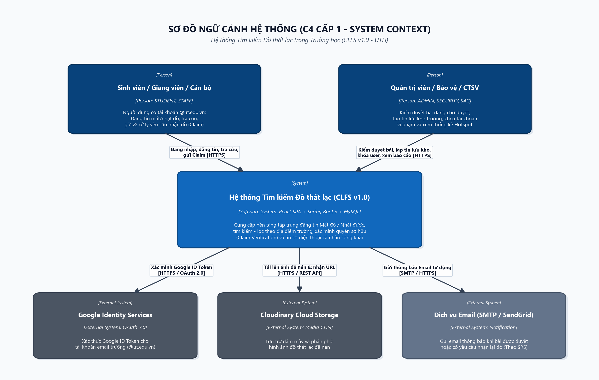

<details>
<summary>Xem mã nguồn Mermaid (C4 Cấp 1 - System Context)</summary>

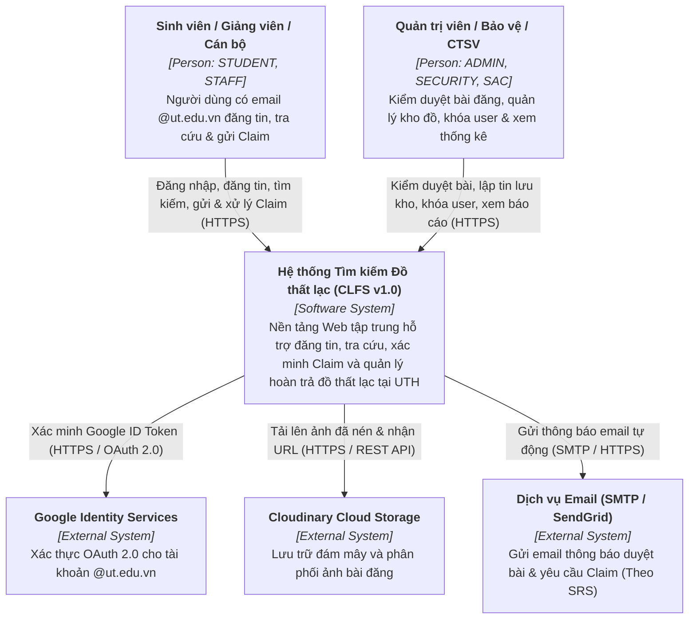

</details>

### 5.1 Mô tả Hệ thống
**Hệ thống Tìm kiếm Đồ thất lạc (CLFS v1.0)** là trung tâm xử lý toàn bộ nghiệp vụ tìm kiếm và hoàn trả tài sản thất lạc trong phạm vi trường Đại học Giao thông vận tải TP.HCM. Hệ thống đóng vai trò cầu nối an toàn giữa **Người làm mất đồ**, **Người nhặt được đồ** và **Bộ phận Quản lý / Bảo vệ nhà trường**, đảm bảo mọi thông tin đăng tải đều gắn với danh tính xác thực và bảo vệ quyền riêng tư của người dùng cho đến khi quyền sở hữu tài sản được xác minh hợp lệ.

### 5.2 Hệ thống Bên ngoài
- **Google Identity Services (OAuth 2.0):**
  - *Mục đích:* Xác thực danh tính người dùng thông qua tài khoản Google của trường mà không cần hệ thống CLFS phải lưu trữ mật khẩu người dùng.
  - *Phương pháp tích hợp (Đã xác minh trong Code):* Frontend nhận `idToken` từ Google và gửi tới Backend (`POST /api/auth/google`). Backend sử dụng thư viện `GoogleIdTokenVerifier` (`com.google.api-client`) để xác minh chữ ký số, kiểm tra `email_verified = true` và đối chiếu đuôi tên miền `@ut.edu.vn` / `@uth.edu.vn`.
- **Dịch vụ Lưu trữ Đám mây (Cloudinary):**
  - *Mục đích:* Lưu trữ bền vững các tệp hình ảnh bài đăng (`ItemImage`) và ảnh bằng chứng nhận đồ (`ProofAttachmentUrl`), giảm tải băng thông cho máy chủ ứng dụng.
  - *Phương pháp tích hợp (Đã xác minh trong Code):* Backend nén ảnh bằng `Thumbnailator` trong bộ nhớ RAM (`byte[]`), sau đó gọi `cloudinary.uploader().upload()` qua SDK `cloudinary-http44` để lưu vào thư mục `uth_lost_and_found` và nhận về `secure_url`. Nếu chưa cấu hình khóa Cloudinary, hệ thống tự động lưu vào đĩa cục bộ (`uploads/`).
- **Dịch vụ Email (SMTP / SendGrid):**
  - *Mục đích:* Gửi thông báo kịp thời tới hộp thư `@ut.edu.vn` của người đăng bài khi bài viết được duyệt/từ chối hoặc khi có người gửi yêu cầu nhận lại đồ (`FR-CLM-03`, `FR-ADM-01`).
  - *Phương pháp tích hợp (Theo đặc tả SRS/WBS – Chưa hiện thực trong Code):* Tích hợp qua giao thức SMTP hoặc REST API của SendGrid từ tầng Service của Backend.

---

## 6. Khung nhìn Logic (C4 Cấp 2 - Container)

Sơ đồ Container (Container Diagram) thể hiện các khối xây dựng kỹ thuật cấp cao bên trong ranh giới hệ thống **CLFS v1.0** và giao thức giao tiếp giữa chúng.

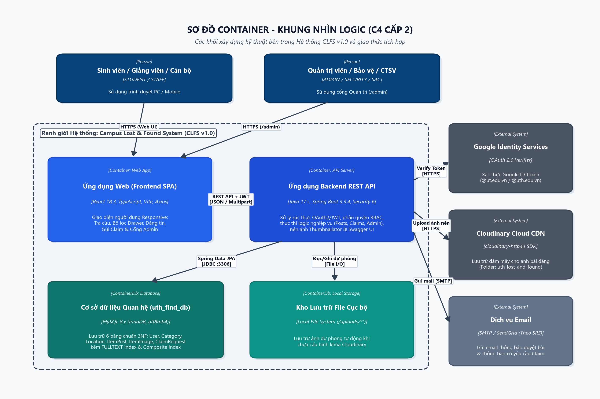

<details>
<summary>Xem mã nguồn Mermaid (C4 Cấp 2 - Container)</summary>

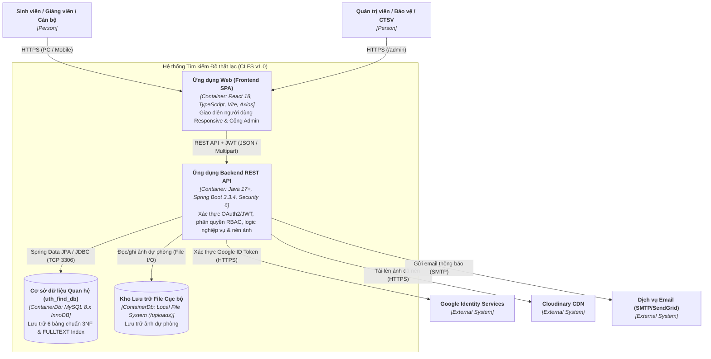

</details>

### 6.1 Mô tả Container

#### 6.1.1 Ứng dụng Web (Frontend SPA)
- **Công nghệ**: React `18.3.1`, TypeScript `5.6.2`, Vite `6.0.5`, React Router DOM `6.28.0`, Axios `1.7.9`, React Hook Form + Zod.
- **Mục đích**: Cung cấp giao diện người dùng đơn trang (Single Page Application) tối ưu hóa cho cả thiết bị di động và máy tính để bàn.
- **Trách nhiệm**: 
  - Hiển thị giao diện theo 3 khung bố cục: `MainLayout` (người dùng chung), `AuthLayout` (đăng nhập), và `AdminLayout` (ban quản trị).
  - Quản lý trạng thái đăng nhập, tự động đính kèm `Authorization: Bearer <token>` vào mọi yêu cầu HTTP qua `axiosClient`.
  - Thực hiện kiểm tra dữ liệu đầu vào phía client (Client-side Validation) cho form đăng bài, bộ lọc tìm kiếm và tải ảnh.

#### 6.1.2 Ứng dụng Backend REST API
- **Công nghệ**: Java `17+`, Spring Boot `3.3.4`, Spring Web MVC, Spring Security 6, Spring Data JPA, JJWT `0.12.6`, Thumbnailator `0.4.20`, SpringDoc OpenAPI `2.6.0`.
- **Mục đích**: Khối xử lý trung tâm (Modular Monolith) đảm nhận cả vai trò cổng API, xác thực/ủy quyền và thực thi quy tắc nghiệp vụ cốt lõi.
- **Trách nhiệm**:
  - Cung cấp các điểm cuối RESTful API chuẩn hóa dưới cấu trúc `ApiResponse<T>` và tài liệu hóa tự động qua Swagger UI (`/swagger-ui.html`).
  - Thực thi xác thực Google OAuth2, cấp phát và kiểm tra JWT Token, cưỡng chế ràng buộc đuôi email trường (`@ut.edu.vn`) và phân quyền RBAC.
  - Kiểm tra giới hạn tệp ảnh ($\le 3$ ảnh/bài, $\le 5\text{MB}$/ảnh), tự động thu phóng ($\le 1280\times 1280$) và nén chất lượng JPEG (`0.75`) bằng `Thumbnailator`.
  - Thực thi toàn bộ quy tắc nghiệp vụ cho bài đăng (`ItemPost`), yêu cầu nhận đồ (`ClaimRequest`) và kiểm duyệt quản trị.

#### 6.1.3 Cơ sở dữ liệu Quan hệ (MySQL Database)
- **Công nghệ**: MySQL `8.x` (Storage Engine: `InnoDB`, Charset: `utf8mb4_unicode_ci`).
- **Mục đích**: Lưu trữ bền vững toàn bộ dữ liệu có cấu trúc của hệ thống (`uth_find_db`).
- **Trách nhiệm**:
  - Đảm bảo tính toàn vẹn tham chiếu (Foreign Keys) và tính chất giao dịch ACID cho 6 bảng dữ liệu.
  - Cung cấp khả năng tìm kiếm toàn văn tốc độ cao thông qua `FULLTEXT INDEX IDX_ItemPost_Search (Title, Description)` và lọc nhanh qua Composite Index `IDX_ItemPost_Filter`.

#### 6.1.4 Kho Lưu trữ Hình ảnh (Cloudinary CDN & Local Storage)
- **Công nghệ**: Cloudinary SDK (`cloudinary-http44 1.39.0`) kết hợp `java.nio.file` + Spring `ResourceHandler` (`/uploads/**`).
- **Mục đích**: Lưu trữ và phục vụ các tệp ảnh minh họa đồ thất lạc và bằng chứng nhận đồ.
- **Trách nhiệm**:
  - Lưu trữ tệp ảnh đã qua bước nén từ Backend trên đám mây Cloudinary (chế độ mặc định) hoặc thư mục cục bộ `uploads/` (chế độ dự phòng).
  - Cung cấp đường dẫn URL tĩnh để Frontend hiển thị trực tiếp trên thẻ bài đăng (`PostCard`) và trang chi tiết (`PostDetailPage`).

---

## 7. Khung nhìn Thành phần (C4 Cấp 3)

Khung nhìn Thành phần (Component View) phân rã chi tiết cả 2 Container ứng dụng chính của hệ thống là **Backend REST API (`capstone-backend`)** và **Frontend SPA (`lost-and-found-uth`)**.

### 7.1 Sơ đồ & Mô tả Thành phần Backend REST API (`capstone-backend`)

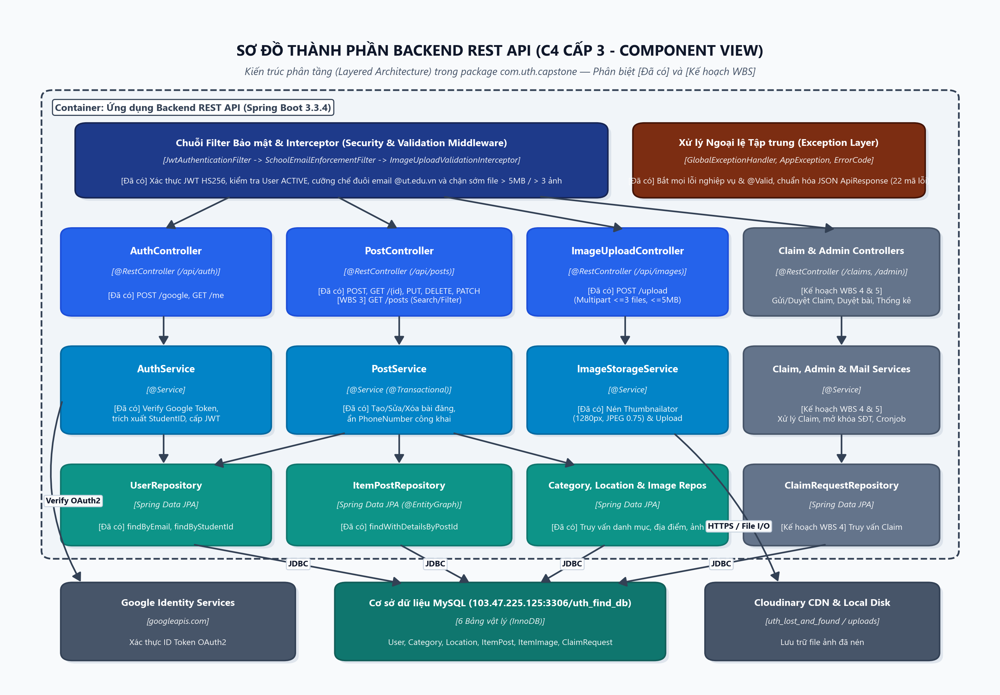

<details>
<summary>Xem mã nguồn Mermaid (C4 Cấp 3 - Backend Components)</summary>

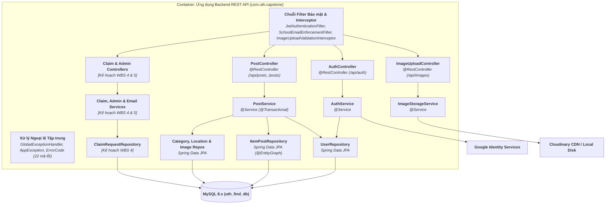

</details>

#### 7.1.1 Bộ điều khiển (Controller Layer — `com.uth.capstone.controller`)
- **`AuthController` *(Đã có trong Source Code)*:** Cung cấp 2 điểm cuối `POST /api/auth/google` (đăng nhập bằng Google ID Token) và `GET /api/auth/me` (trả về thông tin người dùng hiện tại từ JWT).
- **`PostController` *(Đã có trong Source Code)*:** Ánh xạ đồng thời hai tiền tố `/api/posts` và `/posts`, cung cấp 5 điểm cuối:
  - `POST /api/posts`: Tạo mới bài đăng `LOST` / `FOUND` (trả về HTTP `201 Created`).
  - `GET /api/posts/{id}`: Xem chi tiết bài đăng công khai (ẩn trường `PhoneNumber`).
  - `PUT /api/posts/{id}`: Tác giả chỉnh sửa bài đăng khi bài chưa đóng.
  - `DELETE /api/posts/{id}`: Tác giả xóa bài đăng của chính mình.
  - `PATCH /api/posts/{id}/status`: Tác giả cập nhật trạng thái bài đăng sang `RESOLVED` hoặc `CLAIMED`.
- **`ImageUploadController` *(Đã có trong Source Code)*:** Cung cấp điểm cuối `POST /api/images/upload` (`multipart/form-data`) nhận danh sách tối đa 3 file ảnh, trả về `List<ImageUploadResponse>` chứa URL ảnh và tỷ lệ dung lượng đã nén.
- **Các Controller theo lộ trình WBS tiếp theo *(Chưa có trong Source Code)*:**
  - Mở rộng `PostController` (`GET /api/posts` cho tìm kiếm toàn văn, lọc đa tiêu chí và sắp xếp – `WBS 3.1, 3.2`).
  - `ClaimController` (`POST /api/posts/{id}/claims`, `PATCH /api/claims/{claimId}` – `WBS 4.1, 4.2`).
  - `AdminController` (Kiểm duyệt bài đăng `PENDING`, tạo tin lưu kho, quản lý `Category`/`Location`, khóa `User`, thống kê báo cáo – `WBS 5.1..5.4`).

#### 7.1.2 Dịch vụ (Service Layer — `com.uth.capstone.service`)
- **`AuthService` *(Đã có trong Source Code)*:** Xác thực Google ID Token qua `GoogleIdTokenVerifier`, kiểm tra đuôi email trường qua `SchoolEmailValidator`, tự động trích xuất Mã số sinh viên (`8–12 chữ số`) từ địa chỉ email khi khởi tạo tài khoản lần đầu, kiểm tra chặn tài khoản `LOCKED` và gọi `JwtTokenProvider` sinh chuỗi JWT.
- **`PostService` *(Đã có trong Source Code)*:** Thực thi toàn bộ quy tắc nghiệp vụ của bài đăng: tự động gán trạng thái `APPROVED` nếu cấu hình `app.post.auto-approve=true` hoặc người đăng có vai trò `ADMIN`/`SECURITY`/`SAC` (ngược lại gán `PENDING`); kiểm tra quyền tác giả (`verifyPostAuthor`); chặn chỉnh sửa khi bài đăng đã ở trạng thái đóng (`RESOLVED`, `CLAIMED`, `EXPIRED`, `REJECTED`); chuyển đổi Entity sang `PostResponse` công khai không chứa `PhoneNumber`.
- **`ImageStorageService` *(Đã có trong Source Code)*:** Kiểm tra dung lượng ($\le 5\text{MB}$) và định dạng ảnh; sử dụng thư viện `Thumbnailator` thu phóng ảnh về kích thước tối đa `1280x1280` và nén JPEG chất lượng `0.75` (giữ nguyên mảng byte gốc nếu ảnh gốc đã nhỏ hơn bản nén); tải lên Cloudinary hoặc lưu xuống thư mục `uploads/`.
- **Các Service theo lộ trình WBS tiếp theo *(Chưa có trong Source Code)*:** `ClaimService`, `AdminService`, `EmailNotificationService` và Background Scheduler (`@Scheduled` tự động chuyển bài `RESOLVED` quá 60 ngày sang `EXPIRED`).

#### 7.1.3 Kho dữ liệu (Repository Layer — `com.uth.capstone.repository`)
- **`UserRepository` *(Đã có trong Source Code)*:** Kế thừa `JpaRepository<User, Integer>`, cung cấp `findByEmail(String email)`, `existsByEmail(String email)` và `findByStudentId(String studentId)`.
- **`ItemPostRepository` *(Đã có trong Source Code)*:** Kế thừa `JpaRepository<ItemPost, Integer>`, sử dụng `@EntityGraph(attributePaths = {"user", "category", "location", "images"})` trên phương thức `findWithDetailsByPostId(Integer postId)` để tải trọn vẹn chi tiết bài đăng trong 1 truy vấn duy nhất, tránh lỗi `N+1 Queries` và `LazyInitializationException`.
- **`CategoryRepository`, `LocationRepository`, `ItemImageRepository` *(Đã có trong Source Code)*:** Cung cấp các thao tác truy vấn chuẩn của Spring Data JPA cho danh mục, địa điểm và hình ảnh.
- **`ClaimRequestRepository` *(Theo lộ trình WBS 4.1)*:** Truy vấn lịch sử yêu cầu nhận đồ theo `PostID` và `ClaimantUserID`.

#### 7.1.4 Bảo mật, Middleware & Xử lý Ngoại lệ (`security`, `config`, `exception`)
- **`JwtAuthenticationFilter` & `SchoolEmailEnforcementFilter` *(Đã có trong Source Code)*:** Bộ lọc bảo mật kép kiểm tra tính hợp lệ của JWT, đối chiếu trạng thái `UserStatus.ACTIVE` trong CSDL và cưỡng chế kiểm tra tên miền email trường đối với các thao tác ghi dữ liệu (`POST/PUT/PATCH/DELETE` trên `/posts/**`, `/claims/**`, `/images/**`).
- **`ImageUploadValidationInterceptor` *(Đã có trong Source Code)*:** `HandlerInterceptor` chặn sớm các yêu cầu Multipart gửi quá 3 ảnh hoặc có tệp vượt quá `5MB` hoặc sai định dạng (`JPG, JPEG, PNG, WEBP`) trước khi đi vào Controller.
- **`GlobalExceptionHandler`, `AppException`, `ErrorCode` *(Đã có trong Source Code)*:** Quản lý tập trung 22 mã lỗi chuẩn hóa (từ `1001` đến `1021` và `9999`), đảm bảo mọi lỗi nghiệp vụ, lỗi `@Valid` hay lỗi từ chối truy cập (`401`/`403`) đều trả về định dạng JSON `ApiResponse` thống nhất.

### 7.2 Sơ đồ & Mô tả Thành phần Frontend SPA (`lost-and-found-uth`)

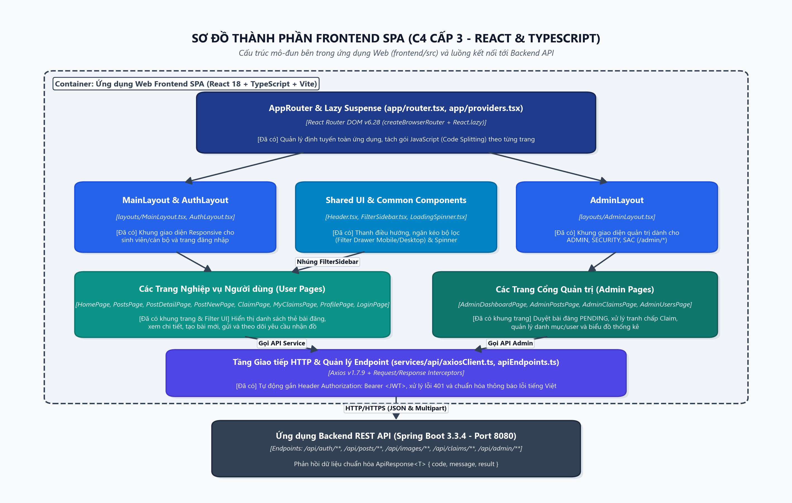

<details>
<summary>Xem mã nguồn Mermaid (C4 Cấp 3 - Frontend SPA Components)</summary>

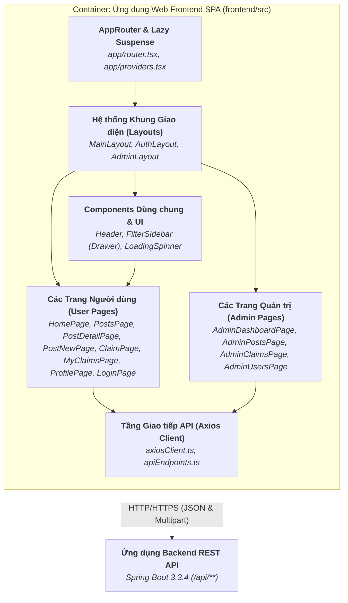

</details>

---

## 8. Kiến trúc Dữ liệu & ERD

### 8.1 Tổng quan Mô hình Dữ liệu
Mô hình dữ liệu của **CLFS v1.0** được thiết kế trên hệ quản trị cơ sở dữ liệu **MySQL 8.x (`uth_find_db`)**, đạt chuẩn hóa **3NF (Third Normal Form)** nhằm loại bỏ dư thừa dữ liệu và đảm bảo toàn vẹn tham chiếu. Mô hình bao gồm **6 thực thể cốt lõi**:
1. **`User`**: Lưu trữ hồ sơ định danh và vai trò phân quyền của người dùng trường học.
2. **`Category`**: Bảng danh mục tham chiếu phân loại đồ vật (đã khởi tạo 6 danh mục chuẩn: *Điện tử, Giấy tờ, Ví, Chìa khóa, Balo, Khác*).
3. **`Location`**: Bảng danh mục tham chiếu các vị trí cố định trong khuôn viên trường UTH (đã khởi tạo 61 vị trí theo cấu trúc *Tòa nhà – Tầng – Phòng/Khu vực*).
4. **`ItemPost`**: Thực thể trung tâm lưu trữ thông tin bài đăng báo mất đồ (`LOST`) hoặc nhặt được đồ (`FOUND`).
5. **`ItemImage`**: Lưu trữ danh sách đường dẫn hình ảnh đính kèm của mỗi bài đăng (quan hệ `1:N` với giới hạn nghiệp vụ tối đa 3 ảnh/bài).
6. **`ClaimRequest`**: Thực thể kết hợp (Associative Entity) giải quyết mối quan hệ nhiều-nhiều (`N:N`) giữa `User` và `ItemPost` trong quy trình gửi bằng chứng xác minh quyền sở hữu để nhận lại đồ.

### 8.2 Sơ đồ Quan hệ Thực thể (ERD)
Sơ đồ dưới đây phản ánh **chính xác 100% cấu trúc bảng vật lý đang vận hành trên MySQL Server (`103.47.225.125:3306/uth_find_db`) và các lớp JPA Entity trong Source Code hiện tại**:

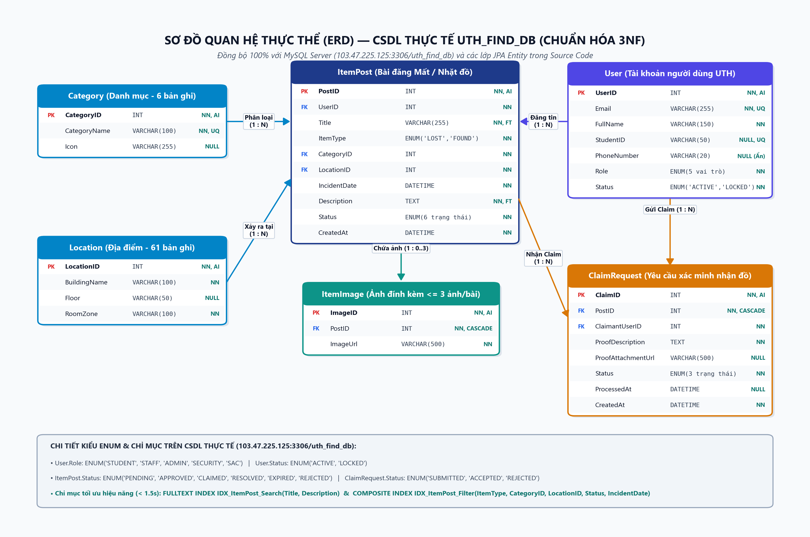

<details>
<summary>Xem mã nguồn Mermaid (ERD - Chuẩn hóa 3NF)</summary>

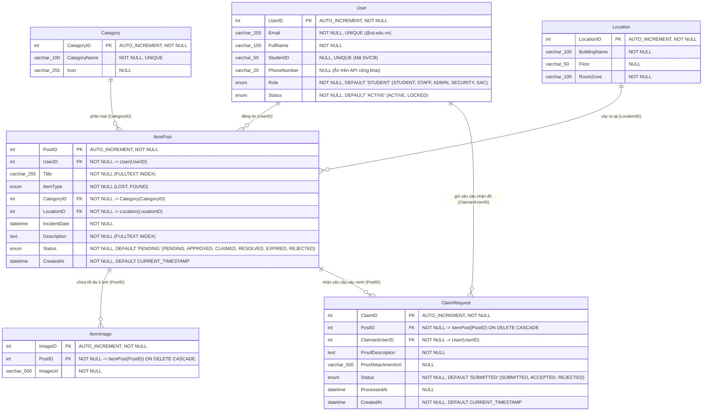

</details>

### 8.3 Mô tả Thực thể & Máy trạng thái Nghiệp vụ (State Machines)

#### 8.3.1 `User` (Ánh xạ lớp `com.uth.capstone.entity.User`)
- **Mục đích**: Lưu trữ thông tin tài khoản người dùng đăng nhập qua Google OAuth2 và trạng thái phân quyền.
- **Thuộc tính Chính**: 
  - `UserID` (`INT`, PK, Auto Increment): Định danh duy nhất của người dùng.
  - `Email` (`VARCHAR(255)`, Unique, Not Null): Địa chỉ email trường học (`@ut.edu.vn` / `@uth.edu.vn`).
  - `FullName` (`VARCHAR(150)`, Not Null): Họ và tên đồng bộ từ hồ sơ Google.
  - `StudentID` (`VARCHAR(50)`, Unique, Nullable): Mã số sinh viên (tự động trích xuất từ email nếu có chuỗi 8–12 chữ số) hoặc mã cán bộ.
  - `PhoneNumber` (`VARCHAR(20)`, Nullable): Số điện thoại liên hệ (bảo mật, không hiển thị công khai).
  - `Role` (`ENUM('STUDENT','STAFF','ADMIN','SECURITY','SAC')`, Not Null, Default `'STUDENT'`): Vai trò phân quyền RBAC.
  - `Status` (`ENUM('ACTIVE','LOCKED')`, Not Null, Default `'ACTIVE'`): Trạng thái hoạt động của tài khoản (`FR-ADM-04`).
- **Quan hệ**: Một-nhiều (`1:N`) với `ItemPost`; Một-nhiều (`1:N`) với `ClaimRequest`.

#### 8.3.2 `Category` (Ánh xạ lớp `com.uth.capstone.entity.Category`)
- **Mục đích**: Phân loại danh mục đồ vật thất lạc.
- **Thuộc tính Chính**:
  - `CategoryID` (`INT`, PK, Auto Increment): Khóa chính danh mục.
  - `CategoryName` (`VARCHAR(100)`, Unique, Not Null): Tên danh mục (gồm 6 danh mục chuẩn: *Điện tử, Giấy tờ, Ví, Chìa khóa, Balo, Khác*).
  - `Icon` (`VARCHAR(255)`, Nullable): Tên định danh hoặc đường dẫn icon hiển thị trên giao diện.
- **Quan hệ**: Một-nhiều (`1:N`) với `ItemPost`.

#### 8.3.3 `Location` (Ánh xạ lớp `com.uth.capstone.entity.Location`)
- **Mục đích**: Chuẩn hóa danh sách các địa điểm cố định trong khuôn viên trường học để hỗ trợ lọc và thống kê điểm nóng (`Hotspot Analysis`).
- **Thuộc tính Chính**:
  - `LocationID` (`INT`, PK, Auto Increment): Khóa chính địa điểm.
  - `BuildingName` (`VARCHAR(100)`, Not Null): Tên tòa nhà hoặc khu vực lớn.
  - `Floor` (`VARCHAR(50)`, Nullable): Tầng cụ thể.
  - `RoomZone` (`VARCHAR(100)`, Not Null): Phòng học, sảnh, căn tin, thư viện, nhà xe... (Ràng buộc duy nhất tổ hợp `UQ_Location_Place(BuildingName, Floor, RoomZone)`).
- **Quan hệ**: Một-nhiều (`1:N`) với `ItemPost`.

#### 8.3.4 `ItemPost` (Ánh xạ lớp `com.uth.capstone.entity.ItemPost`)
- **Mục đích**: Đại diện cho một bài đăng báo mất đồ hoặc nhặt được đồ.
- **Thuộc tính Chính**:
  - `PostID` (`INT`, PK, Auto Increment): Khóa chính bài đăng.
  - `UserID`, `CategoryID`, `LocationID` (`INT`, FK, Not Null): Khóa ngoại liên kết tới người đăng, danh mục và địa điểm.
  - `Title` (`VARCHAR(255)`, Not Null) & `Description` (`TEXT`, Not Null): Tiêu đề và mô tả đặc điểm đồ vật.
  - `ItemType` (`ENUM('LOST','FOUND')`, Not Null): Phân loại tin báo mất (`LOST`) hay nhặt được (`FOUND`).
  - `IncidentDate` (`DATETIME`, Not Null): Thời điểm xảy ra sự việc mất hoặc nhặt đồ.
  - `Status` (`ENUM('PENDING','APPROVED','CLAIMED','RESOLVED','EXPIRED','REJECTED')`, Not Null, Default `'PENDING'`): Vòng đời trạng thái của bài đăng.
  - `CreatedAt` (`DATETIME`, Not Null): Thời điểm tạo bài đăng.
- **Quan hệ**: Nhiều-một (`N:1`) với `User`, `Category`, `Location`; Một-nhiều (`1:N`) với `ItemImage` và `ClaimRequest`.

#### 8.3.5 `ItemImage` (Ánh xạ lớp `com.uth.capstone.entity.ItemImage`)
- **Mục đích**: Lưu trữ đường dẫn các hình ảnh đính kèm của một bài đăng (`ItemPost`).
- **Thuộc tính Chính**:
  - `ImageID` (`INT`, PK, Auto Increment): Khóa chính hình ảnh.
  - `PostID` (`INT`, FK, Not Null): Tham chiếu tới `ItemPost(PostID)` với quy tắc `ON DELETE CASCADE`.
  - `ImageUrl` (`VARCHAR(500)`, Not Null): Đường dẫn URL của ảnh trên Cloudinary hoặc `/uploads/...`.
- **Quan hệ**: Nhiều-một (`N:1`) với `ItemPost` (kiểm soát tối đa 3 bản ghi trên mỗi `PostID` tại tầng Service).

#### 8.3.6 `ClaimRequest` (Bảng CSDL `ClaimRequest` & Enum `ClaimStatus.java`)
- **Mục đích**: Lưu trữ yêu cầu xác minh quyền sở hữu của người mất đồ gửi tới bài đăng nhặt được đồ *(Lớp Entity JPA sẽ được tạo trong WBS 4.1)*.
- **Thuộc tính Chính**:
  - `ClaimID` (`INT`, PK, Auto Increment): Khóa chính yêu cầu nhận đồ.
  - `PostID` (`INT`, FK, Not Null) & `ClaimantUserID` (`INT`, FK, Not Null): Bài đăng được yêu cầu và người gửi yêu cầu.
  - `ProofDescription` (`TEXT`, Not Null): Mô tả đặc điểm nhận dạng riêng biệt chứng minh quyền sở hữu.
  - `ProofAttachmentUrl` (`VARCHAR(500)`, Nullable): Đường dẫn ảnh bằng chứng (hóa đơn, ảnh chụp cũ...).
  - `Status` (`ENUM('SUBMITTED','ACCEPTED','REJECTED')`, Not Null, Default `'SUBMITTED'`): Trạng thái xét duyệt yêu cầu.
  - `ProcessedAt` (`DATETIME`, Nullable) & `CreatedAt` (`DATETIME`, Not Null): Thời gian xử lý và thời gian gửi yêu cầu.
- **Quan hệ**: Nhiều-một (`N:1`) với `ItemPost` và `User`.

#### 8.3.7 Sơ đồ Chuyển trạng thái Nghiệp vụ (State Machine Diagrams)
Vòng đời trạng thái của **Bài đăng (`PostStatus`)** và **Yêu cầu nhận đồ (`ClaimStatus`)** tuân theo quy tắc chuyển trạng thái nghiêm ngặt dưới đây:

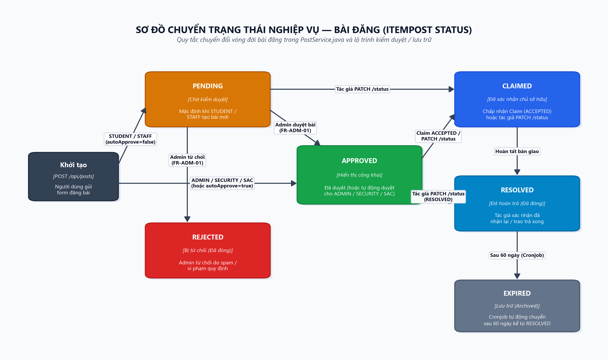

<details>
<summary>Xem mã nguồn Mermaid (State Machine - ItemPost Status)</summary>

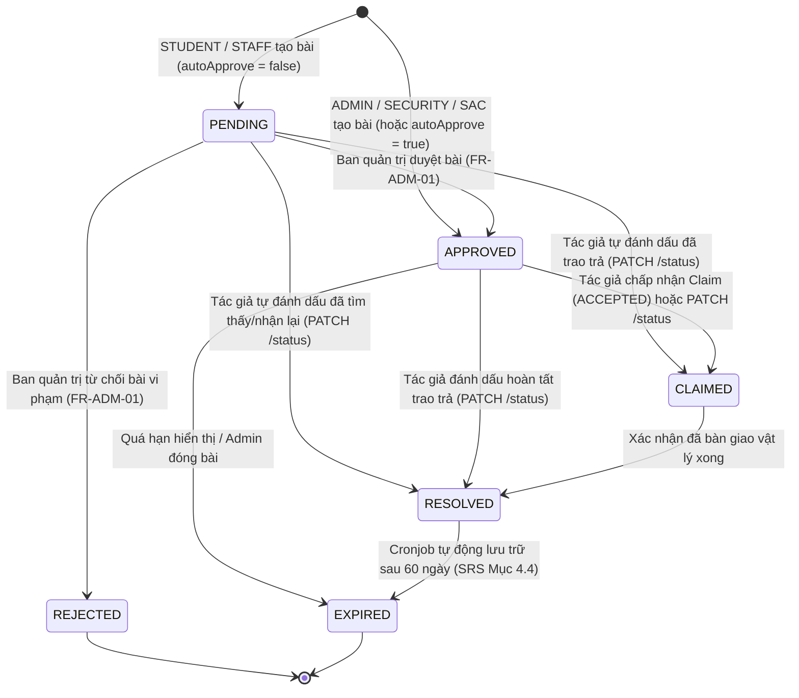

</details>

**Bảng Quy tắc Nghiệp vụ theo Trạng thái `ItemPost` (Đã xác minh trong `PostService.java`):**

| Trạng thái | Ý nghĩa Nghiệp vụ | Hiển thị Công khai? | Cho phép Tác giả Sửa (`PUT`)? | Cho phép Gửi Claim mới? |
|:-----------|:------------------|:-------------------:|:-----------------------------:|:-----------------------:|
| **`PENDING`** | Bài đăng mới tạo của Sinh viên/Cán bộ, đang chờ kiểm duyệt. | Không (Chỉ tác giả & Admin xem) | ✅ Có | ❌ Không |
| **`APPROVED`** | Đã được duyệt và đang hiển thị công khai để tìm kiếm. | ✅ Có | ✅ Có | ✅ Có (nếu `FOUND`) |
| **`CLAIMED`** | Đã có người xác minh sở hữu thành công (`Claim = ACCEPTED`), đang chờ/đã nhận đồ. | ✅ Có (Gắn nhãn Đã nhận) | ❌ Không (`POST_ALREADY_CLOSED`) | ❌ Không |
| **`RESOLVED`** | Món đồ đã hoàn tất trao trả cho chủ nhân. | ✅ Có (Gắn nhãn Đã hoàn trả) | ❌ Không (`POST_ALREADY_CLOSED`) | ❌ Không |
| **`EXPIRED`** | Bài đăng đã chuyển sang chế độ lưu trữ (sau 60 ngày kể từ khi `RESOLVED`). | Không (Lưu trữ lịch sử) | ❌ Không (`POST_ALREADY_CLOSED`) | ❌ Không |
| **`REJECTED`** | Bài đăng bị từ chối duyệt do spam hoặc vi phạm quy định. | Không | ❌ Không (`POST_ALREADY_CLOSED`) | ❌ Không |

#### 8.3.8 Ghi chú Phân tích SA & Đề xuất Mở rộng cho Giai đoạn Module 4–5
Khi triển khai sang **Module 4 (Claim)** và **Module 5 (Admin)**, nhóm phát triển cần lưu ý 3 quy ước thiết kế sau để đáp ứng trọn vẹn SRS mà không phá vỡ cấu trúc hiện tại:
1. **Xử lý lý do từ chối bài đăng (`FR-ADM-01`):** Khi Admin từ chối bài đăng (`Status = REJECTED`), lý do từ chối được truyền trong DTO Request của API Admin để gửi trực tiếp qua Email thông báo cho sinh viên; nếu muốn lưu lịch sử lý do trên Web, có thể bổ sung cột tùy chọn `RejectReason VARCHAR(500) NULL` vào bảng `ItemPost`.
2. **Xử lý bài đăng "Đang lưu giữ tại kho trường" (`FR-ADM-02`):** Một bài đăng được xác định là *"Đang lưu giữ tại kho trường"* khi bài có `ItemType = FOUND` và được tạo bởi tài khoản có `Role IN ('ADMIN', 'SECURITY', 'SAC')` (hoặc đặt tại `Location` là Văn phòng Đoàn / Phòng Bảo vệ). Nhờ quy tắc trong `PostService.resolveInitialPostStatus()`, các bài đăng này đã tự động được gán `Status = APPROVED` ngay khi tạo.
3. **Xử lý đồng bộ khi chấp nhận Claim (`FR-CLM-04`):** Khi một `ClaimRequest` trên bài đăng được chuyển sang `ACCEPTED`, hệ thống sẽ tự động cập nhật `ItemPost.Status = CLAIMED`, ghi nhận `ProcessedAt = LocalDateTime.now()`, và từ chối (`REJECTED`) các `ClaimRequest` còn lại đang ở trạng thái `SUBMITTED` của cùng bài đăng đó để tránh hai người cùng được hẹn đến nhận một món đồ.

### 8.4 Chiến lược Lưu trữ Dữ liệu & Tìm kiếm Tiếng Việt
- **Cơ sở dữ liệu Chính**: MySQL 8.x (`InnoDB`) lưu trữ toàn bộ dữ liệu giao dịch.
- **Chiến lược Tìm kiếm Lai (Hybrid Search Strategy) cho Tiếng Việt (`FR-SRCH-01`):**
  - *Bối cảnh:* Chỉ mục `FULLTEXT INDEX IDX_ItemPost_Search ON ItemPost(Title, Description)` cho tốc độ rất cao với cụm từ dài, nhưng cấu hình mặc định của MySQL (`innodb_ft_min_token_size = 3` hoặc `4`) có thể bỏ sót các từ khóa đơn tiếng Việt ngắn 2–3 ký tự (ví dụ: `"ví"`, `"thẻ"`, `"mũ"`, `"ô"`).
  - *Giải pháp kiến trúc:* Tại tầng `ItemPostRepository` (khi hiện thực hóa `WBS 3.1`), kết hợp `MATCH(Title, Description) AGAINST(:keyword IN NATURAL LANGUAGE MODE)` với điều kiện dự phòng `OR LOWER(Title) LIKE LOWER(CONCAT('%', :keyword, '%'))` trên tập bản ghi đã được thu hẹp bởi `INDEX IDX_ItemPost_Filter (ItemType, CategoryID, LocationID, Status, IncidentDate)`. Cách tiếp cận này vừa đảm bảo tìm chính xác 100% từ khóa ngắn tiếng Việt, vừa giữ thời gian phản hồi dưới `1.5 giây` trên `50.000` bản ghi.
- **Chiến lược Lưu trữ Tệp đa phương tiện (Media Storage):** Hình ảnh được nén giảm dung lượng từ `30%–70%` qua `Thumbnailator` trước khi đẩy lên Cloudinary CDN (hoặc đĩa cục bộ `uploads/`).
- **Chính sách Lưu trữ Dài hạn (Data Retention & Archiving):** Theo `SRS Mục 4.4` và `WBS 5.4`, các bài đăng đã hoàn tất trao trả (`RESOLVED`) sau **60 ngày** sẽ được tiến trình nền (`@Scheduled(cron = "0 0 2 * * *")` chạy lúc 02:00 sáng hàng ngày) tự động chuyển sang trạng thái lưu trữ (`EXPIRED`).

### 8.5 Luồng Dữ liệu
- **Thao tác Ghi (Write Operations):** Toàn bộ thao tác tạo/sửa/xóa đi qua các phương thức `@Transactional` tại tầng `Service` của Backend, kiểm tra ràng buộc khóa ngoại (`Category`, `Location`, `User`) trước khi ghi xuống MySQL.
- **Thao tác Đọc (Read Operations):** Sử dụng `@Transactional(readOnly = true)` kết hợp `@EntityGraph` (`ItemPostRepository.findWithDetailsByPostId`) để gom các bảng liên kết (`User`, `Category`, `Location`, `ItemImage`) trong một truy vấn `LEFT JOIN` duy nhất, sau đó ánh xạ sang `PostResponse` (đã loại bỏ `PhoneNumber`).

---

## 9. Tích hợp & Luồng Dữ liệu

### 9.1 Kiến trúc Tích hợp
Sơ đồ tuần tự (`sequenceDiagram`) dưới đây minh họa 2 luồng tích hợp đã vận hành trong mã nguồn (**Luồng 1: Đăng nhập Google OAuth2 & Cấp JWT** và **Luồng 2: Tải/Nén ảnh & Tạo Bài đăng mới**) cùng **Luồng 3: Gửi & Duyệt Yêu cầu Nhận lại đồ (Claim)** theo đặc tả SRS/WBS:

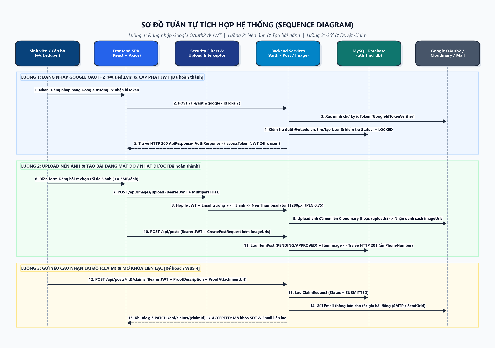

<details>
<summary>Xem mã nguồn Mermaid (Sequence Diagram - OAuth2, Upload & Claim)</summary>

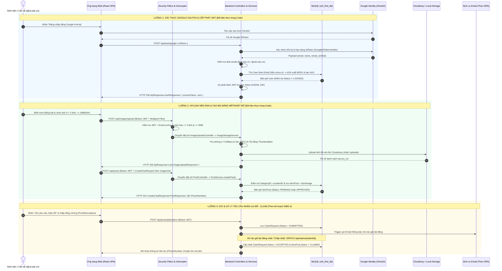

</details>

### 9.2 Mẫu Tích hợp & Đặc tả Hợp đồng API (API & Error Catalog)
- **RESTful API Đồng bộ (Synchronous REST/JSON):** Toàn bộ giao tiếp giữa `React SPA` và `Spring Boot Backend` thực hiện qua HTTP/HTTPS với định dạng dữ liệu JSON được chuẩn hóa bởi lớp vỏ `ApiResponse<T>`:
  ```json
  {
    "code": 1000,
    "message": "Thành công",
    "result": { ... }
  }
  ```
- **Truyền tải Đa phương tiện tách bước (Two-step Media Upload Pattern):** Tải và nén ảnh qua `POST /api/images/upload` (`multipart/form-data`) để nhận danh sách URL trước, sau đó truyền `imageUrls` vào `POST /api/posts` hoặc `PUT /api/posts/{id}`.

#### 9.2.1 Bảng Đặc tả Toàn bộ Hợp đồng RESTful API (API Endpoint Catalog)

| Phân hệ (Module) | Phương thức & Đường dẫn (Endpoint URI) | Quyền truy cập (`Role`) | Dữ liệu Đầu vào (`Request`) | Dữ liệu Phản hồi (`result`) | Trạng thái Code |
|:-----------------|:---------------------------------------|:------------------------|:----------------------------|:----------------------------|:----------------|
| **1. Auth** | `POST /api/auth/google` | Công khai (`PermitAll`) | `GoogleLoginRequest { idToken }` | `AuthResponse { accessToken, tokenType, expiresIn, user }` | **Đã hoàn thành** |
| **1. Auth** | `GET /api/auth/me` | Đã đăng nhập (`All Roles`) | Header `Authorization: Bearer <JWT>` | `UserResponse` | **Đã hoàn thành** |
| **1. Storage** | `POST /api/images/upload` | Đã đăng nhập (`@ut.edu.vn`) | `MultipartFile[] files` ($\le 3$ ảnh, $\le 5\text{MB}$) | `List<ImageUploadResponse>` | **Đã hoàn thành** |
| **2. Posts** | `POST /api/posts` *(hoặc `/posts`)* | Đã đăng nhập (`@ut.edu.vn`) | `CreatePostRequest` | `PostResponse` (HTTP `201`) | **Đã hoàn thành** |
| **2. Posts** | `GET /api/posts/{id}` *(hoặc `/posts/{id}`)* | Công khai (`PermitAll`) | Path variable `id` | `PostResponse` *(Ẩn `PhoneNumber`)* | **Đã hoàn thành** |
| **2. Posts** | `PUT /api/posts/{id}` *(hoặc `/posts/{id}`)* | Chính tác giả bài đăng | `UpdatePostRequest` | `PostResponse` | **Đã hoàn thành** |
| **2. Posts** | `DELETE /api/posts/{id}` *(hoặc `/posts/{id}`)* | Chính tác giả bài đăng | Path variable `id` | `null` (Xóa thành công) | **Đã hoàn thành** |
| **2. Posts** | `PATCH /api/posts/{id}/status` | Chính tác giả bài đăng | `UpdatePostStatusRequest { status }` | `PostResponse` (`RESOLVED`/`CLAIMED`) | **Đã hoàn thành** |
| **3. Search & Catalog** | `GET /api/posts` | Công khai (`PermitAll`) | Query params: `q, itemType, status, categoryId, locationId, fromDate, toDate, sort, page, size` | `Page<PostResponse>` | **Kế hoạch WBS 3.1 & 3.2** |
| **3. Search & Catalog** | `GET /api/categories` & `GET /api/locations` | Công khai (`PermitAll`) | Không | Danh sách `Category` / `Location` | **Kế hoạch WBS 3.2** |
| **4. Claims** | `POST /api/posts/{id}/claims` | Đã đăng nhập (`@ut.edu.vn`) | `CreateClaimRequest { proofDescription, proofAttachmentUrl }` | `ClaimResponse` (`SUBMITTED`) | **Kế hoạch WBS 4.1** |
| **4. Claims** | `PATCH /api/claims/{claimId}` | Tác giả bài đăng / Admin | `ProcessClaimRequest { status }` | `ClaimResponse` *(Mở khóa SĐT khi `ACCEPTED`)* | **Kế hoạch WBS 4.2** |
| **5. Admin** | `GET /api/admin/posts/pending` | `ADMIN`, `SECURITY`, `SAC` | Query params phân trang | Danh sách bài chờ duyệt (`PENDING`) | **Kế hoạch WBS 5.1** |
| **5. Admin** | `PATCH /api/admin/posts/{id}/moderation` | `ADMIN`, `SECURITY`, `SAC` | `{ status: APPROVED/REJECTED, reason }` | `PostResponse` + Trigger Email | **Kế hoạch WBS 5.1** |
| **5. Admin** | `PATCH /api/admin/users/{id}/status` | `ADMIN` | `{ status: ACTIVE / LOCKED }` | `UserResponse` | **Kế hoạch WBS 5.3** |
| **5. Admin** | `GET /api/admin/statistics` | `ADMIN`, `SECURITY`, `SAC` | Query params `month, year` | Thống kê tỷ lệ hoàn trả & Hotspot | **Kế hoạch WBS 5.4** |

#### 9.2.2 Bảng Danh mục Mã lỗi Chuẩn hóa Toàn cục (`ErrorCode.java`)

| Mã (`code`) | Hằng số `ErrorCode` | HTTP Status | Thông điệp Phản hồi (`message`) |
|:-----------:|:--------------------|:-----------:|:--------------------------------|
| `1000` | *(Success)* | `200` / `201` | Thành công |
| `1001` | `INVALID_KEY` | `400 Bad Request` | Mã lỗi không hợp lệ |
| `1002` | `USER_EXISTED` | `400 Bad Request` | Người dùng đã tồn tại |
| `1003` | `USER_NOT_EXISTED` | `404 Not Found` | Không tìm thấy người dùng |
| `1004` | `UNAUTHENTICATED` | `401 Unauthorized` | Chưa xác thực đăng nhập |
| `1005` | `UNAUTHORIZED` | `403 Forbidden` | Bạn không có quyền thực hiện hành động này |
| `1006` | `RESOURCE_NOT_FOUND` | `404 Not Found` | Không tìm thấy tài nguyên yêu cầu |
| `1007` | `INVALID_REQUEST` | `400 Bad Request` | Dữ liệu yêu cầu không hợp lệ |
| `1008` | `INVALID_GOOGLE_TOKEN` | `401 Unauthorized` | Google ID Token không hợp lệ hoặc đã hết hạn |
| `1009` | `INVALID_SCHOOL_EMAIL` | `403 Forbidden` | Chỉ chấp nhận tài khoản email trường học (@ut.edu.vn) |
| `1010` | `USER_LOCKED` | `403 Forbidden` | Tài khoản của bạn đã bị khóa do vi phạm quy định sử dụng |
| `1011` | `INVALID_TOKEN` | `401 Unauthorized` | Token xác thực không hợp lệ hoặc đã hết hạn |
| `1012` | `TOO_MANY_IMAGES` | `400 Bad Request` | Mỗi bài đăng chỉ được phép đính kèm tối đa 3 ảnh |
| `1013` | `FILE_TOO_LARGE` | `413 Payload Too Large` | Dung lượng mỗi ảnh không được vượt quá 5MB |
| `1014` | `INVALID_IMAGE_FORMAT` | `400 Bad Request` | Định dạng file không hợp lệ (chỉ chấp nhận ảnh JPG, JPEG, PNG, WEBP) |
| `1015` | `IMAGE_UPLOAD_FAILED` | `500 Internal Server Error` | Lỗi trong quá trình nén hoặc tải ảnh lên hệ thống lưu trữ |
| `1016` | `POST_NOT_FOUND` | `404 Not Found` | Không tìm thấy bài đăng yêu cầu |
| `1017` | `CATEGORY_NOT_FOUND` | `404 Not Found` | Không tìm thấy danh mục đồ vật |
| `1018` | `LOCATION_NOT_FOUND` | `404 Not Found` | Không tìm thấy địa điểm trong trường |
| `1019` | `NOT_POST_AUTHOR` | `403 Forbidden` | Bạn chỉ có quyền thao tác trên bài đăng của chính mình |
| `1020` | `POST_ALREADY_CLOSED` | `400 Bad Request` | Không thể chỉnh sửa bài đăng đã đóng hoặc đã hoàn tất trao trả |
| `1021` | `INVALID_POST_STATUS_TRANSITION` | `400 Bad Request` | Tác giả chỉ được phép đổi trạng thái bài đăng thành Đã nhận lại (RESOLVED hoặc CLAIMED) |
| `9999` | `UNCATEGORIZED_EXCEPTION` | `500 Internal Server Error` | Lỗi không xác định từ hệ thống |

### 9.3 Tích hợp Bên ngoài
- **Google Identity Services (`google-api-client`):** Tích hợp xác thực phía máy chủ (Server-side Token Verification) thông qua `NetHttpTransport` và `GsonFactory` để xác minh trực tiếp `idToken` do Google cấp.
- **Cloudinary REST API (`cloudinary-http44`):** Tích hợp tải mảng byte ảnh đã nén lên đám mây qua HTTPS kèm cơ chế tự động chuyển đổi sang lưu trữ cục bộ (`Local Storage Fallback`) khi thiếu cấu hình khóa API.
- **Dịch vụ Email (`SMTP / SendGrid`):** Tích hợp gửi thư thông báo tự động khi có sự kiện thay đổi trạng thái kiểm duyệt hoặc phát sinh yêu cầu nhận lại đồ *(thuộc lộ trình WBS 1.3, 4.1, 5.1)*.

---

## 10. Kiến trúc Bảo mật

### 10.1 Nguyên tắc Bảo mật
- **Bảo vệ Nhiều lớp (Defense in Depth):** Một yêu cầu HTTP đến hệ thống phải đi qua 4 lớp kiểm soát tuần tự:
  1. **Lớp CORS & Multipart Limit:** Kiểm soát nguồn gốc tên miền gọi API (`CorsConfig`) và chặn kích thước gói tin vượt quá `5MB/file` hoặc `20MB/request` (`application.yml`).
  2. **Lớp Security Filter Chain:** `JwtAuthenticationFilter` xác thực chữ ký JWT & kiểm tra tài khoản `LOCKED` $\rightarrow$ `SchoolEmailEnforcementFilter` cưỡng chế đuôi email `@ut.edu.vn` $\rightarrow$ Phân quyền đường dẫn theo `Role` (`SecurityConfig`).
  3. **Lớp Interceptor & DTO Validation:** `ImageUploadValidationInterceptor` kiểm tra định dạng MIME/đuôi file ảnh; Jakarta Validation (`@Valid`, `@NotBlank`, `@NotNull`, `@Size`) kiểm tra cấu trúc dữ liệu đầu vào.
  4. **Lớp Nghiệp vụ (Service Ownership Check):** Kiểm tra quyền sở hữu bản ghi (`verifyPostAuthor`) đảm bảo người dùng chỉ có thể sửa/xóa/đổi trạng thái bài đăng do chính mình tạo.
- **Đặc quyền Tối thiểu (Least Privilege):** Người dùng chưa đăng nhập chỉ được phép thực hiện các truy vấn đọc công khai (`GET /api/posts/**`, `GET /api/categories/**`, `GET /api/locations/**`, `GET /uploads/**`). Các quyền kiểm duyệt và quản trị hệ thống (`/api/admin/**`) bị cô lập nghiêm ngặt cho 3 vai trò `ADMIN`, `SECURITY`, `SAC`.
- **Không Tin tưởng Mặc định (Zero Trust on Input & Identity):** Không tin tưởng dữ liệu kiểm tra từ phía trình duyệt; mọi ràng buộc (đuôi email trường, số lượng ảnh, trạng thái tài khoản, quyền tác giả) đều được xác minh lại tại Backend.

### 10.2 Xác thực & Ủy quyền
- **Xác thực (Authentication):**
  - Sử dụng **Google OAuth 2.0 (ID Token)** kết hợp **Stateless JWT (`HS256`)**.
  - Khi đăng nhập thành công, `JwtTokenProvider` tạo chuỗi JWT chứa `subject` (Email), `userId`, `role`, `fullName`, thời điểm phát hành (`iat`) và thời điểm hết hạn (`exp`, mặc định `86.400.000 ms` = **24 giờ**).
- **Ủy quyền (Authorization - RBAC):**
  - Phản hồi lỗi bảo mật được chuẩn hóa qua `CustomAuthenticationEntryPoint` (trả về HTTP `401` kèm mã lỗi `1004 - UNAUTHENTICATED`) và `CustomAccessDeniedHandler` (trả về HTTP `403` kèm mã lỗi `1005 - UNAUTHORIZED`).

#### 10.2.1 Ma trận Phân quyền Chi tiết theo Vai trò (RBAC Permission Matrix)

| Hành động / Chức năng Nghiệp vụ | Khách (`Guest`) | `STUDENT` | `STAFF` | `SECURITY` (Bảo vệ) | `SAC` (Phòng CTSV) | `ADMIN` |
|:--------------------------------|:---------------:|:---------:|:-------:|:-------------------:|:------------------:|:-------:|
| Xem danh sách, tìm kiếm, lọc bài đăng (`APPROVED`) | ✅ | ✅ | ✅ | ✅ | ✅ | ✅ |
| Xem chi tiết bài đăng công khai (ẩn `PhoneNumber`) | ✅ | ✅ | ✅ | ✅ | ✅ | ✅ |
| Đăng nhập bằng Google trường (`@ut.edu.vn`) | ✅ | ✅ | ✅ | ✅ | ✅ | ✅ |
| Tải lên và nén ảnh đính kèm ($\le 3$ ảnh, $\le 5\text{MB}$) | ❌ | ✅ | ✅ | ✅ | ✅ | ✅ |
| Tạo bài đăng mới *(Mặc định chờ duyệt `PENDING`)* | ❌ | ✅ | ✅ | — | — | — |
| Tạo bài đăng mới / Tin lưu kho *(Tự động duyệt `APPROVED`)* | ❌ | ❌ | ❌ | ✅ | ✅ | ✅ |
| Sửa / Xóa / Đánh dấu `RESOLVED` bài đăng của chính mình | ❌ | ✅ | ✅ | ✅ | ✅ | ✅ |
| Gửi yêu cầu nhận đồ (`ClaimRequest`) & Xét duyệt Claim bài của mình | ❌ | ✅ | ✅ | ✅ | ✅ | ✅ |
| Kiểm duyệt bài đăng chờ duyệt (`PENDING` $\rightarrow$ `APPROVED`/`REJECTED`) | ❌ | ❌ | ❌ | ✅ | ✅ | ✅ |
| Lập biên bản bàn giao đồ lưu kho & Xử lý Claim tranh chấp | ❌ | ❌ | ❌ | ✅ | ✅ | ✅ |
| Xem báo cáo thống kê tỷ lệ hoàn trả & điểm nóng (`Hotspot`) | ❌ | ❌ | ❌ | ✅ | ✅ | ✅ |
| Quản lý danh mục hệ thống (`Category`, `Location`) | ❌ | ❌ | ❌ | ❌ | ✅ | ✅ |
| Khóa / Mở khóa tài khoản người dùng vi phạm (`ACTIVE` $\leftrightarrow$ `LOCKED`) | ❌ | ❌ | ❌ | ❌ | ❌ | ✅ |

### 10.3 Bảo mật Dữ liệu
- **Bảo vệ Thông tin Định danh Cá nhân (PII Protection):**
  - Trường `PhoneNumber` của người đăng bài bị loại bỏ hoàn toàn khỏi DTO phản hồi công khai (`PostResponse.AuthorPublicInfo` tại `PostService.toPublicPostResponse()`).
  - Số điện thoại và kênh liên lạc chỉ được tiết lộ cho hai bên khi yêu cầu nhận lại đồ (`ClaimRequest`) chuyển sang trạng thái `ACCEPTED` (`SRS Mục 6.3`).
  - Hệ thống nhắc nhở người dùng che mờ thông tin nhạy cảm (số CCCD, mã CVV/số thẻ ngân hàng) trước khi tải ảnh lên (`FR-POST-04`).
- **Bảo vệ Thông tin Bí mật Hệ thống (Secrets Management):**
  - Tuyệt đối không lưu cứng mật khẩu cơ sở dữ liệu hay khóa API trong mã nguồn. Toàn bộ thông tin nhạy cảm trong `application.yml` được nạp qua biến môi trường hoặc tệp `.env`: `${DB_PASSWORD}`, `${JWT_SECRET}`, `${GOOGLE_CLIENT_ID}`, `${CLOUDINARY_API_KEY}`, `${CLOUDINARY_API_SECRET}`.
- **Mã hóa Khi Truyền (Encryption in Transit):** Giao tiếp với Google Identity Services và Cloudinary sử dụng hoàn toàn giao thức `HTTPS (TLS)`.

### 10.4 Bảo mật Mạng
- **Kiểm soát Nguồn gốc Chéo (CORS Policy):** `CorsConfig.java` chỉ cho phép các nguồn gốc xác định (`http://localhost:3000`, `http://localhost:5173`, `http://localhost:8080`) với các phương thức `GET, POST, PUT, DELETE, PATCH, OPTIONS`.
- **Chống Tấn công Tải tệp Độc hại (File Upload Security):**
  - Kiểm tra kép cả `Content-Type` (`image/jpeg`, `image/jpg`, `image/png`, `image/webp`) và phần mở rộng tên tệp (`jpg`, `jpeg`, `png`, `webp`).
  - Đọc và giải mã luồng ảnh qua `ImageIO.read()` và tái mã hóa (re-encode) sang định dạng JPEG chuẩn bằng `Thumbnailator`, giúp loại bỏ các đoạn mã độc ẩn trong metadata (EXIF payload) của tệp ảnh gốc.

### 10.5 Tuân thủ
- Tuân thủ **Quy chế Công tác Sinh viên và Quy định Bảo quản Tài sản** của Trường Đại học Giao thông vận tải TP.HCM (UTH) (`SRS Mục 1.4`).
- Tuân thủ nguyên tắc bảo vệ dữ liệu cá nhân của sinh viên và cán bộ giảng viên trong môi trường giáo dục.

---

## 11. Khung nhìn Triển khai

Sơ đồ Triển khai (Deployment Diagram) mô tả kiến trúc hạ tầng thực tế đang vận hành kết hợp phương án triển khai Production theo `WBS Mục 6.2`.

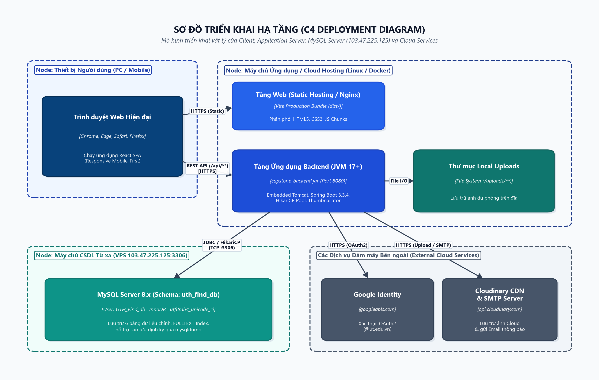

<details>
<summary>Xem mã nguồn Mermaid (C4 Deployment Diagram)</summary>

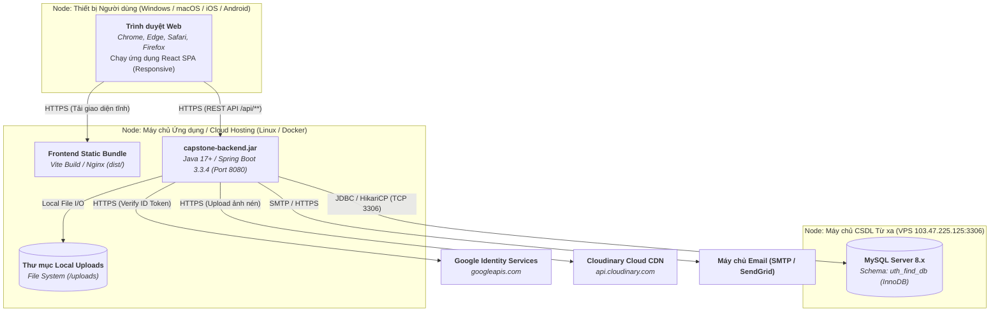

</details>

### 11.1 Tổng quan Hạ tầng

#### 11.1.1 Tầng Web (Frontend Tier)
- **Công nghệ**: Ứng dụng React + TypeScript được đóng gói tĩnh qua lệnh `npm run build` (`tsc -b && vite build`).
- **Môi trường Phát triển**: Chạy trên Vite Dev Server tại cổng `http://localhost:5173`.
- **Môi trường Triển khai (Theo WBS 6.2)**: Phân phối gói tài nguyên tĩnh (`dist/`) qua Web Server (Nginx) hoặc dịch vụ Cloud Static Hosting, hỗ trợ tải lười (`Lazy Loading`) từng trang theo route.

#### 11.1.2 Tầng Ứng dụng & API (Backend Application Tier)
- **Công nghệ**: Đóng gói thành tệp thực thi độc lập `capstone-backend-0.0.1-SNAPSHOT.jar` (kèm Embedded Apache Tomcat lắng nghe tại cổng `8080`).
- **Quản lý Kết nối CSDL (Connection Pooling):** Sử dụng **HikariCP** tích hợp sẵn trong Spring Boot Data JPA (quản lý hồ kết nối tới MySQL `103.47.225.125:3306`, tái sử dụng kết nối TCP để giảm độ trễ bắt tay mạng).
- **Quản lý Cấu hình**: Nạp cấu hình linh hoạt từ tệp `.env` hoặc biến môi trường hệ điều hành thông qua chỉ thị `spring.config.import: optional:file:.env[.properties]`.

#### 11.1.3 Tầng Dữ liệu (Database Tier — Đã vận hành thực tế)
- **Máy chủ CSDL Chính**: Máy chủ MySQL 8.x vận hành tại địa chỉ IP `103.47.225.125`, cổng `3306`, tên cơ sở dữ liệu `uth_find_db`, tài khoản kết nối `UTH_Find_db`.
- **Quản lý Lược đồ (Schema Validation)**: Sử dụng chế độ `spring.jpa.hibernate.ddl-auto: validate` nhằm đảm bảo ứng dụng luôn kiểm tra tính khớp nối 100% giữa các lớp JPA Entity và cấu trúc bảng vật lý trên máy chủ mà không tự ý làm hỏng cấu trúc dữ liệu đang có.
- **Chiến lược Sao lưu (Database Backup):** Hỗ trợ xuất bản sao lưu định kỳ bằng `mysqldump --single-transaction uth_find_db` để bảo toàn cấu trúc 6 bảng và dữ liệu danh mục chuẩn (`Category`, `Location`).

#### 11.1.4 Tầng Lưu trữ Đa phương tiện (Media Storage Tier)
- **Lưu trữ Chính**: Đám mây **Cloudinary** (thư mục `uth_lost_and_found`), giúp phân phối ảnh qua mạng lưới CDN tốc độ cao.
- **Lưu trữ Dự phòng**: Thư mục cục bộ `uploads/` trên máy chủ Backend, được ánh xạ tĩnh qua `WebMvcConfig` (`/uploads/**`).

### 11.2 Chiến lược Triển khai
- **Quy trình Quản lý Nhánh & Tích hợp (Git Workflow):**
  - Nhánh `main`: Lưu giữ mã nguồn ổn định qua các mốc phát hành.
  - Nhánh `dev`: Nhánh tích hợp chính của đội ngũ phát triển Backend và Frontend; mọi tính năng được kiểm thử đơn vị (`mvn test` / `vitest`) trước khi đẩy lên `origin/dev`.
- **Đóng gói & Triển khai (Theo WBS 6.2):** Đóng gói ứng dụng Backend qua Maven (`mvn clean package`) và Frontend qua Vite, cấu hình biến môi trường Production trước khi khởi chạy.

### 11.3 Kiến trúc Mạng
- Giao tiếp giữa trình duyệt người dùng và Backend API đi qua giao thức HTTP/HTTPS với kiểm soát CORS chặt chẽ.
- Kết nối từ Backend tới máy chủ MySQL (`103.47.225.125:3306`) sử dụng trình điều khiển `com.mysql.cj.jdbc.Driver` với mã hóa ký tự `UTF-8` và múi giờ chuẩn `UTC` (`serverTimezone=UTC&characterEncoding=UTF-8`).

---

## 12. Yêu cầu Phi Chức năng

### 12.1 Hiệu suất
- **Thời gian Phản hồi Tìm kiếm (`SRS Mục 6.2`):** Thời gian phản hồi API tìm kiếm và lọc kết quả bài đăng đạt **dưới 1.5 giây** đối với cơ sở dữ liệu có quy mô tới **50.000 bản ghi** (sử dụng `FULLTEXT INDEX` và `Composite B-Tree Index`).
- **Tối ưu Dung lượng Hình ảnh (`SRS Mục 4.4`):** Toàn bộ hình ảnh tải lên ($\le 5\text{MB}$/ảnh) được máy chủ tự động thu phóng về tối đa `1280x1280 px` và nén JPEG ở mức chất lượng `0.75`, giúp giảm đáng kể thời gian tải trang trên mạng di động của sinh viên.
- **Tải Lười Giao diện (Code Splitting):** Frontend sử dụng `React.lazy()` và `Suspense` trong `router.tsx` để chia nhỏ gói JavaScript, chỉ tải mã nguồn của trang khi người dùng điều hướng tới.

### 12.2 Khả năng Mở rộng
- **Mở rộng Ngang Tầng Ứng dụng (Stateless Horizontal Scaling):** Nhờ thiết kế xác thực hoàn toàn phi trạng thái bằng JWT (`SessionCreationPolicy.STATELESS`) và lưu trữ ảnh trên Cloudinary CDN, có thể chạy nhiều instance Backend song song phía sau bộ cân bằng tải mà không cần đồng bộ phiên làm việc.
- **Mở rộng Lưu trữ:** Tách biệt hoàn toàn việc lưu trữ tệp ảnh sang Cloudinary giúp dung lượng cơ sở dữ liệu MySQL chỉ lưu chuỗi URL ngắn (`VARCHAR(500)`), giữ cho kích thước bảng `ItemImage` luôn nhẹ khi số lượng bài đăng tăng cao.

### 12.3 Khả dụng
- **Dự phòng Lưu trữ Tự động (Storage Fallback):** Khi dịch vụ đám mây Cloudinary chưa được cấu hình hoặc gặp sự cố, `ImageStorageService` tự động chuyển sang chế độ lưu trữ cục bộ (`LOCAL`) mà không làm gián đoạn chức năng đăng bài của người dùng.
- **Hoạt động Liên tục 24/7:** Đáp ứng nhu cầu tra cứu và đăng tin thất lạc của sinh viên bất kỳ thời điểm nào trong ngày trên trình duyệt máy tính và điện thoại.

### 12.4 Độ tin cậy
- **Toàn vẹn Giao dịch (Transactional Integrity):** Các thao tác tạo bài đăng kèm danh sách ảnh (`createPost`), cập nhật bài đăng (`updatePost`) và xóa bài đăng (`deletePost`) đều được bọc trong `@Transactional`, đảm bảo tự động hoàn tác (Rollback) toàn bộ nếu có bất kỳ bước nào thất bại.
- **Xử lý Lỗi Toàn diện:** `GlobalExceptionHandler` bắt toàn bộ ngoại lệ nghiệp vụ (`AppException`), lỗi kiểm tra dữ liệu (`MethodArgumentNotValidException`), lỗi vượt dung lượng tệp (`MaxUploadSizeExceededException`) và lỗi hệ thống, đảm bảo máy chủ không bao giờ trả về trang lỗi HTML thô hay làm sập tiến trình.
- **Thời gian Chờ Kết nối (Request Timeout):** `axiosClient.ts` phía Frontend thiết lập ngưỡng timeout `15.000 ms` (15 giây) và tự động chuẩn hóa thông báo lỗi tiếng Việt thân thiện khi mất kết nối mạng.

### 12.5 Khả năng Bảo trì & Giám sát (Maintainability & Audit Logging)
- **Kiến trúc Phân tầng & Quy ước Đặt tên Chuẩn mực:** Tuân thủ nghiêm ngặt quy tắc phân chia package (`config`, `controller`, `dto`, `entity`, `enums`, `exception`, `repository`, `security`, `service`) được quy định trong `README.md`.
- **Kiểm thử Tự động (Automated Testing):** Đã xây dựng bộ Unit Test & Integration Test bằng JUnit 5, Mockito và Spring MockMvc (`AuthSecurityTest`, `PostServiceTest`, `PostControllerTest`, `ImageStorageServiceTest`) để kiểm chứng tự động các quy tắc bảo mật và nghiệp vụ.
- **Ghi Nhật ký Hệ thống (SLF4J Logging):** Ghi log chi tiết thông số nén ảnh (dung lượng gốc, dung lượng sau nén, tỷ lệ tiết kiệm `%`, nhà cung cấp lưu trữ `CLOUDINARY`/`LOCAL` trong `ImageStorageService`) và truy vấn SQL (`hibernate.show_sql` & `format_sql`).

### 12.6 Khả năng Sử dụng & Thiết kế Giao diện Người dùng (UI/UX Design Principles)

#### 12.6.1 Áp dụng 3 Nguyên tắc Vàng trong Thiết kế Giao diện (Theo Mandel's 3 Golden Rules)
Thiết kế giao diện của **CLFS v1.0** tuân thủ chặt chẽ 3 nguyên tắc vàng của kỹ thuật thiết kế giao diện phần mềm:
1. **Đặt người dùng vào vị trí kiểm soát (Place the User in Control):**
   - Cho phép người dùng tự do kết hợp hoặc xóa nhanh từng bộ lọc tìm kiếm (`onReset` trong `FilterSidebar.tsx`).
   - Mọi thao tác mang tính phá hủy hoặc thay đổi trạng thái quan trọng (Xóa bài đăng, Đánh dấu đã nhận lại đồ, Chấp nhận Claim, Khóa tài khoản) đều có bước xác nhận (Modal Confirmation) để tránh thao tác nhầm.
   - Ẩn toàn bộ độ phức tạp kỹ thuật (nén ảnh, xác thực JWT, phân trang) phía sau giao diện trực quan.
2. **Giảm tải trí nhớ ngắn hạn của người dùng (Reduce the User's Memory Load):**
   - Thay vì bắt sinh viên tự gõ tên tòa nhà hay danh mục dễ sai chính tả, hệ thống cung cấp danh sách chọn sẵn (`Dropdown / Chip Select`) gồm 6 `Category` kèm biểu tượng (`Icon`) và 61 `Location` chuẩn của trường UTH.
   - Tự động điền sẵn Họ tên và Mã số sinh viên (`StudentID`) từ tài khoản Google `@ut.edu.vn`.
   - Phân biệt thị giác tức thì bằng màu sắc chuẩn hóa (`SRS Mục 5.1`): Nhãn **"Mất đồ" (Màu đỏ)** và **"Nhặt được" (Màu xanh lá)** giúp người dùng nhận diện loại tin ngay lập tức mà không cần đọc kỹ toàn bộ văn bản.
3. **Đảm bảo tính nhất quán trên toàn hệ thống (Make the Interface Consistent):**
   - Sử dụng hệ thống biến CSS toàn cục (`global.css`) và 3 khung bố cục cố định (`MainLayout`, `AuthLayout`, `AdminLayout`).
   - Mọi thông báo lỗi từ Backend (`ErrorCode`) và phản hồi thao tác (Toast/Alert) đều hiển thị ở vị trí và định dạng thống nhất bằng tiếng Việt rõ ràng.

#### 12.6.2 Sơ đồ Luồng Điều hướng Màn hình (Screen Navigation Flow)

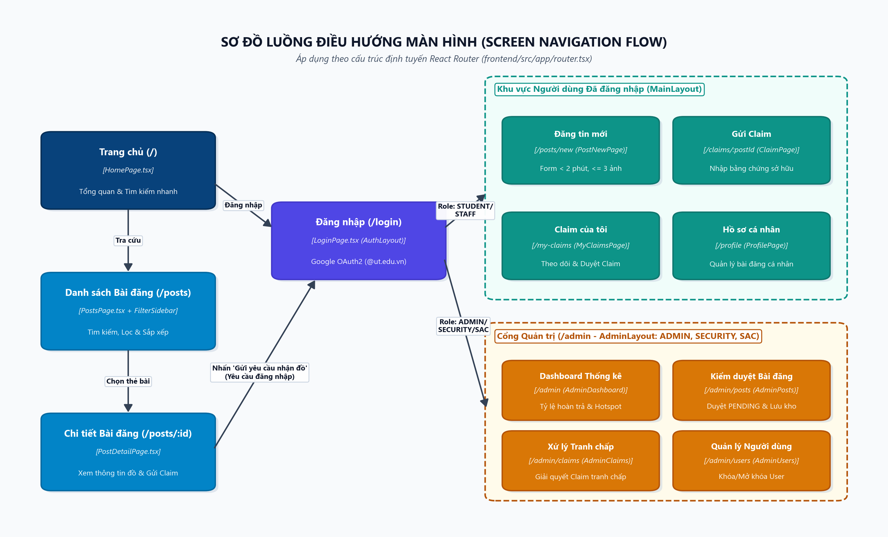

<details>
<summary>Xem mã nguồn Mermaid (Screen Navigation Flow)</summary>

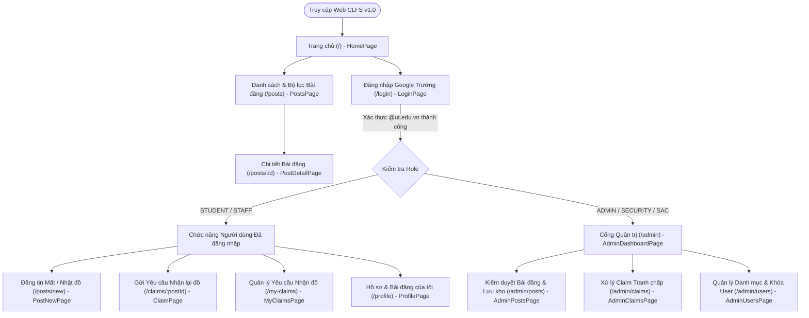

</details>

---

## 13. Quyết định Kiến trúc

### 13.1 Nhật ký Quyết định

| ID | Quyết định | Trạng thái | Ngày | Lý do |
|----|------------|------------|------|-------|
| **ADR-001** | Áp dụng kiến trúc **Layered Modular Monolith (Spring Boot 3)** kết hợp **React SPA** | Đã chấp nhận & Đã triển khai | 10/2026 | Phù hợp với quy mô đồ án và đội ngũ 3 thành viên; cho phép phát triển song song FE/BE mà không chịu chi phí vận hành phức tạp của Microservices. |
| **ADR-002** | Sử dụng **MySQL 8.x (InnoDB)** chuẩn hóa 3NF kèm **Hybrid Full-Text Index** làm CSDL chính | Đã chấp nhận & Đã triển khai | 10/2026 | Đảm bảo tính toàn vẹn ACID cho quy trình đăng tin/nhận đồ và đáp ứng yêu cầu tìm kiếm toàn văn $< 1.5\text{s}$ trên $50.000$ bản ghi mà không cần cài đặt thêm Elasticsearch. |
| **ADR-003** | Xác thực bằng **Google Identity Services (OAuth 2.0)** kết hợp **Stateless JWT** và bộ lọc đuôi email `@ut.edu.vn` | Đã chấp nhận & Đã triển khai | 11/2026 | Tận dụng hạ tầng email trường học để định danh chính xác sinh viên/cán bộ, chống tài khoản ảo/lừa đảo và loại bỏ rủi ro lưu trữ mật khẩu. |
| **ADR-004** | Nén ảnh phía Server bằng **Thumbnailator** và lưu trữ **Hybrid (Cloudinary + Local Fallback)** | Đã chấp nhận & Đã triển khai | 11/2026 | Kiểm soát dung lượng lưu trữ ($\le 3$ ảnh, $\le 5\text{MB}$), tăng tốc độ tải ảnh qua CDN và đảm bảo hệ thống vẫn chạy ổn định ở môi trường cục bộ khi chưa có khóa Cloudinary. |
| **ADR-005** | **Ẩn số điện thoại cá nhân (`PhoneNumber`)** ở cấp độ DTO công khai và chỉ mở khóa qua quy trình **Claim Verification** | Đã chấp nhận & Đã triển khai | 11/2026 | Tuân thủ yêu cầu bảo mật & quyền riêng tư (`SRS Mục 6.3`), ngăn chặn triệt để việc thu thập số điện thoại công khai để quấy rối hoặc lừa đảo. |

### 13.2 Quyết định Chính

#### ADR-001: Kiến trúc Layered Modular Monolith (Spring Boot 3) & React SPA
- **Ngữ cảnh**: Dự án cần một kiến trúc rõ ràng để các thành viên Backend và Frontend làm việc độc lập, dễ kiểm thử, dễ bảo trì và triển khai trong phạm vi thời gian của đồ án Công nghệ Phần mềm.
- **Quyết định**: Tách biệt hệ thống thành **Frontend SPA (React + TypeScript + Vite)** và **Backend RESTful API (Spring Boot 3)** tổ chức theo 4 tầng (`Controller` $\rightarrow$ `Service` $\rightarrow$ `Repository` $\rightarrow$ `Entity`).
- **Hậu quả**: 
  - ✅ Phát triển song song hiệu quả giữa Frontend và Backend thông qua hợp đồng OpenAPI/Swagger.
  - ✅ Độ gắn kết nội bộ cao (High Cohesion), độ phụ thuộc giữa các tầng thấp (Loose Coupling), dễ dàng viết Unit Test cho từng Service/Controller.
  - ✅ Triển khai đơn giản chỉ với 1 gói thực thi `.jar` và 1 gói giao diện tĩnh.
  - ❌ Toàn bộ các module nghiệp vụ cùng chia sẻ chung một tiến trình JVM và một cơ sở dữ liệu MySQL.

#### ADR-002: Cơ sở dữ liệu MySQL 8.x với Full-Text Index & PhysicalNamingStrategyStandardImpl
- **Ngữ cảnh**: Hệ thống cần lưu trữ dữ liệu có tính quan hệ chặt chẽ giữa Người dùng – Bài đăng – Danh mục – Địa điểm – Hình ảnh – Yêu cầu nhận đồ, đồng thời phải đáp ứng tốc độ tìm kiếm từ khóa dưới 1.5 giây với 50.000 bản ghi trên máy chủ Linux MySQL dùng chung.
- **Quyết định**: Sử dụng **MySQL 8.x (InnoDB)** chuẩn hóa 3NF, đánh chỉ mục `FULLTEXT INDEX IDX_ItemPost_Search(Title, Description)` kết hợp `Composite Index` và cấu hình Hibernate `PhysicalNamingStrategyStandardImpl` + `ddl-auto: validate`.
- **Hậu quả**:
  - ✅ Đảm bảo tính nhất quán dữ liệu (ACID) và toàn vẹn khóa ngoại.
  - ✅ Ánh xạ chính xác 100% với tên bảng/cột PascalCase trên máy chủ MySQL Linux mà không cần thêm hệ thống tìm kiếm bên ngoài.
  - ❌ Mọi thay đổi về cấu trúc bảng phải được thực hiện qua câu lệnh SQL trên máy chủ CSDL trước khi cập nhật lớp Entity.

#### ADR-003: Xác thực Google OAuth 2.0 kết hợp Stateless JWT & SchoolEmailEnforcementFilter
- **Ngữ cảnh**: Yêu cầu bắt buộc của nhà trường (`SRS Mục 2.4`) là chỉ sinh viên và cán bộ có email trường (`@ut.edu.vn`) mới được đăng bài và gửi yêu cầu nhận đồ.
- **Quyết định**: Sử dụng `GoogleIdTokenVerifier` để xác thực `idToken` từ Google, kết hợp phát hành JWT (`HS256`) và kiểm tra kép tại `SchoolEmailEnforcementFilter`.
- **Hậu quả**:
  - ✅ Ngăn chặn hiệu quả tin giả, spam và tài khoản nặc danh bên ngoài trường.
  - ✅ Tự động trích xuất được Mã số sinh viên (`StudentID`) và Họ tên từ tài khoản Google mà người dùng không cần đăng ký thủ công.
  - ❌ Phụ thuộc vào kết nối mạng tới máy chủ Google khi thực hiện bước đăng nhập ban đầu.

---

## 14. Rủi ro & Giảm thiểu

### 14.1 Rủi ro Kỹ thuật

| Rủi ro | Tác động | Xác suất | Biện pháp Giảm thiểu (Đã áp dụng & Kế hoạch) |
|--------|----------|----------|----------------------------------------------|
| **Quá tải dung lượng lưu trữ và băng thông do người dùng tải ảnh độ phân giải lớn** | Cao | Cao | **Đã áp dụng:** Chặn ở tầng `ImageUploadValidationInterceptor` ($\le 3$ ảnh/bài, $\le 5\text{MB}$/ảnh) và tự động thu phóng ($\le 1280\text{px}$) + nén JPEG (`0.75`) qua `Thumbnailator` trước khi lưu. |
| **Gián đoạn kết nối hoặc thiếu cấu hình dịch vụ Cloudinary** | Trung bình | Trung bình | **Đã áp dụng:** Thiết kế cơ chế tự động chuyển đổi dự phòng (`Fallback`) sang lưu trữ tệp cục bộ (`uploads/`) trong `ImageStorageService`. |
| **Bất đồng bộ hợp đồng dữ liệu (API Endpoint / DTO Schema) giữa Frontend và Backend** | Trung bình | Cao | **Cần thực hiện ngay khi ghép nối FE-BE:** Đồng bộ hóa `apiEndpoints.ts`, `axiosClient.ts` và `types/index.ts` của Frontend theo đúng Bảng Đặc tả API (Mục 9.2.1) và cấu trúc `ApiResponse { code, message, result }`. |
| **Suy giảm tốc độ truy vấn hoặc bỏ sót từ khóa tiếng Việt ngắn trên bảng `ItemPost`** | Cao | Trung bình | **Đã áp dụng & Kế hoạch:** Sử dụng kết hợp `FULLTEXT INDEX` + `Composite Index` + điều kiện `LIKE` dự phòng cho từ ngắn (Mục 8.4), dùng `@EntityGraph` tránh lỗi `N+1 Queries`, và chạy Cronjob tự động chuyển bài `RESOLVED` quá 60 ngày sang trạng thái lưu trữ `EXPIRED` (`WBS 5.4`). |

### 14.2 Rủi ro Vận hành

| Rủi ro | Tác động | Xác suất | Biện pháp Giảm thiểu |
|--------|----------|----------|----------------------|
| **Lộ thông tin nhạy cảm (`DB_PASSWORD`, `JWT_SECRET`, `CLOUDINARY_API_SECRET`) trong kho mã nguồn Git** | Nghiêm trọng | Thấp | **Đã áp dụng:** Tuyệt đối không ghi cứng mật khẩu trong `application.yml`; nạp toàn bộ thông qua biến môi trường (`${DB_PASSWORD}`) và đưa tệp `.env` vào `.gitignore`. |
| **Xung đột mã nguồn hoặc mất dữ liệu khi nhiều thành viên cùng làm việc trên nhánh `dev` và CSDL dùng chung** | Cao | Trung bình | **Đã áp dụng:** Thực hiện quy tắc bắt buộc `git pull origin dev` trước mỗi ca làm việc, bật chế độ `ddl-auto: validate` để ngăn Hibernate tự ý xóa/sửa bảng trên máy chủ MySQL dùng chung (`103.47.225.125`). |

### 14.3 Rủi ro Nghiệp vụ

| Rủi ro | Tác động | Xác suất | Biện pháp Giảm thiểu |
|--------|----------|----------|----------------------|
| **Đối tượng xấu lợi dụng thông tin bài đăng để gọi điện lừa đảo hoặc mạo danh nhận đồ** | Nghiêm trọng | Trung bình | **Đã áp dụng & Kế hoạch:** Ẩn hoàn toàn `PhoneNumber` trên API công khai (`PostService`); bắt buộc đăng nhập bằng email trường `@ut.edu.vn`; yêu cầu cung cấp bằng chứng sở hữu (`ProofDescription`) qua quy trình `ClaimRequest` trước khi mở khóa liên lạc. |
| **Lộ thông tin nhạy cảm trên ảnh chụp giấy tờ tùy thân / thẻ ngân hàng nhặt được** | Cao | Trung bình | **Theo SRS FR-POST-04:** Hiển thị cảnh báo trực quan trên giao diện đăng bài yêu cầu người nhặt che mờ số CCCD, mã thẻ ngân hàng trước khi tải ảnh lên, kết hợp khâu kiểm duyệt bài đăng (`PENDING` $\rightarrow$ `APPROVED`) của Ban quản trị. |
| **Người dùng đăng tin spam hoặc ngôn từ phản cảm** | Trung bình | Trung bình | **Đã áp dụng & Kế hoạch:** Bài đăng của `STUDENT`/`STAFF` mặc định ở trạng thái chờ duyệt (`PENDING`); Admin có công cụ từ chối bài viết (`REJECTED`) và khóa tài khoản vi phạm (`UserStatus.LOCKED`). |

---

## Phụ lục

### A. Thuật ngữ
- **CLFS**: Campus Lost & Found System — Hệ thống Tìm kiếm Đồ thất lạc trong Trường học.
- **UTH**: Trường Đại học Giao thông vận tải TP.HCM (University of Transport Ho Chi Minh City).
- **SAC**: Student Affairs Committee / Phòng Công tác Sinh viên (một trong các vai trò kiểm duyệt trên hệ thống).
- **Claim (`ClaimRequest`)**: Yêu cầu xác nhận quyền sở hữu đối với món đồ nhặt được kèm theo mô tả/hình ảnh bằng chứng xác minh.
- **Resolved (`RESOLVED`)**: Trạng thái bài đăng khi món đồ thất lạc đã được hoàn trả thành công cho chủ sở hữu.
- **Hotspot Analysis**: Phân tích thống kê các khu vực/tòa nhà trong trường thường xuyên xảy ra mất đồ nhiều nhất.
- **RBAC**: Role-Based Access Control — Kiểm soát truy cập dựa trên vai trò (`STUDENT`, `STAFF`, `ADMIN`, `SECURITY`, `SAC`).
- **JWT**: JSON Web Token — Chuỗi mã hóa xác thực phi trạng thái.
- **SSO / OAuth 2.0**: Single Sign-On / Giao thức ủy quyền xác thực qua Google Identity Services.

### B. Tham khảo
- Tài liệu Đặc tả Yêu cầu Phần mềm — *Software Requirements Specification (SRS) – Campus Lost & Found System (CLFS v1.0)*
- Tài liệu Phân rã Công việc Kỹ thuật — *Work Breakdown Structure (WBS) – Hệ thống Tìm kiếm Đồ thất lạc (v1.0)*
- Thiết kế Cơ sở dữ liệu — *ERD Schema SQL (`schema.sql` / `uth_find_db`)*
- [Tài liệu Kiến trúc Backend — README.md](../README.md)
- Tài liệu Bài giảng Thiết kế Phần mềm — *Software Engineering Chapter 3: Software Design*
- [Mô hình C4 (C4 Model for Visualizing Software Architecture)](https://c4model.com/)
- [IEEE Std 830-1998 & Khung nhìn Kiến trúc 4+1](https://en.wikipedia.org/wiki/4%2B1_architectural_view_model)

### C. Lịch sử Tài liệu
| Phiên bản | Ngày | Tác giả | Thay đổi |
|-----------|------|---------|----------|
| 1.0 | 14/11/2026 | Nhóm Đồ án CNPM UTH | Hoàn thiện Tài liệu Kiến trúc Giải pháp (SAD) cho hệ thống Tìm kiếm Đồ thất lạc trong Trường học (CLFS). |

---

**Trạng thái Tài liệu**: Bản chính thức (Hoàn thiện)  
**Ngày Xem xét Tiếp theo**: Theo từng giai đoạn Sprint / WBS  
**Phê duyệt**: Nhóm Đồ án CNPM UTH
